# env 实现机制图解

> 撰写日期：2026-10-12 ｜ 代码基线：env **v2.0.2**（commit `ec2c251`）+ env-windows **v2.1.0**（commit `fc857c5a`）+ rt-thread **v5.3.0**
> 源码位置：`~/workspace/repo/env`、`~/workspace/repo/env-windows`、`~/workspace/repo/rt-thread`
> 本文是《Env实现机制深度分析.md》的**图解配套版**：以图为主重建全部结论，行号引证与文字版一致。
> 图类型：mermaid 流程图 / 时序图 / 类图 / 状态图（VSCode、Typora、GitHub 可直接渲染）+ ASCII 目录图。
> 阅读路线：§1 总览 → §2 安装与激活 → §3 venv 自举 → §4 menuconfig → §5 pkgs → §6 SDK → §7 插件与 WebUI → §8 构建与导出 → §9 Windows 链 → §10 设计评价。

---

## 1. 总体架构：一张图看懂 env 是什么

### 1.1 分层架构图

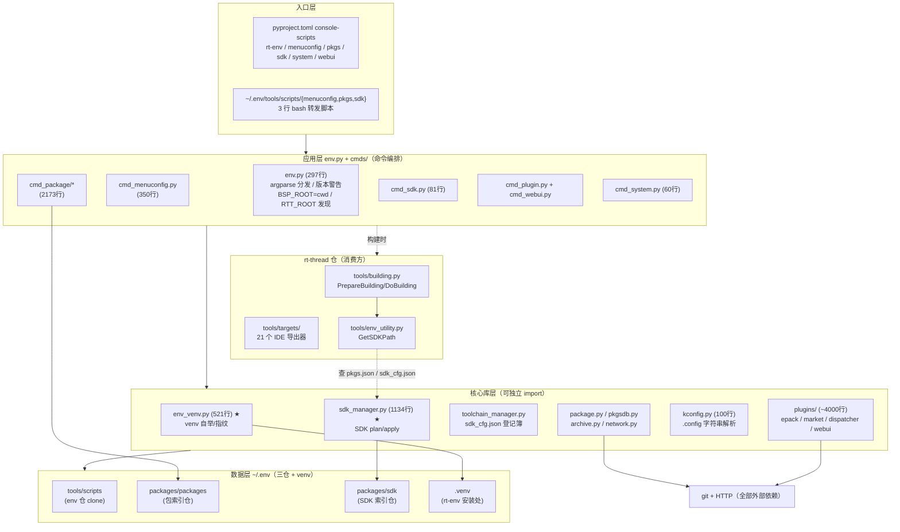

**要点**：
- env 与 west 最深的差异：**west 是"全局 pip 包 + workspace"，env 是"venv 自举 + ~/.env 数据目录"**——env 的代码本身就是 `~/.env/tools/scripts` 这个 git clone，激活时装进 venv。
- **BSP 根 = cwd**（`env.py:209-210`），无任何向上搜索机制；RTT 根靠扫描 BSP Kconfig 的 `lines[i+3]`（`env.py:171`）。
- 核心外部依赖仅 git + HTTP；构建/烧录全部由 rt-thread 侧 SCons 世界承担。

### 1.2 三个核心抽象（后文所有图围绕它们）

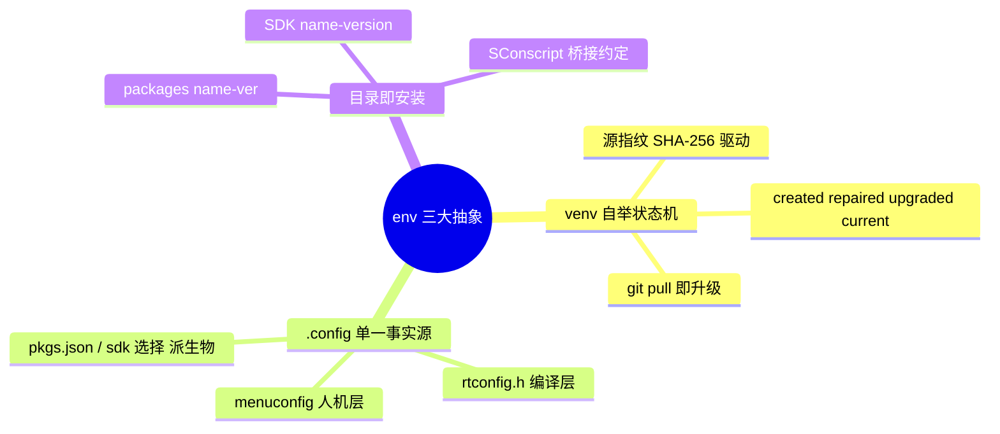

---

## 2. 生命周期：从安装到命令执行

### 2.1 安装 + 激活总流程（POSIX）

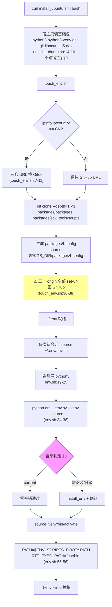

**会话级承诺**：env.sh 全部 `export` 只影响当前 shell；不写 rc 文件、不写系统配置——每次新终端都要重新 source。

### 2.2 命令执行链（`main()`，env.py:249-266）

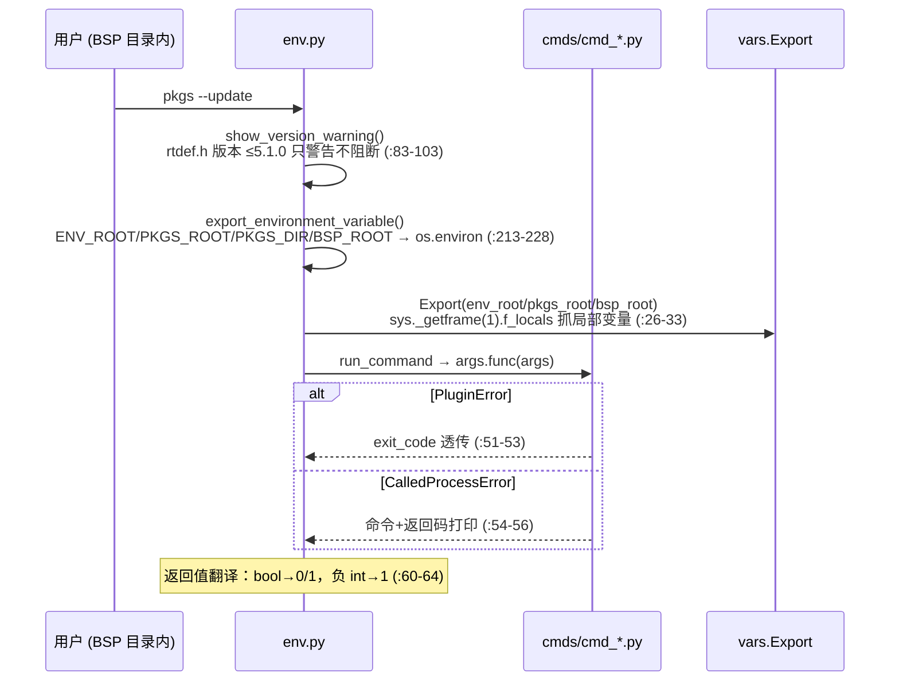

---

## 3. venv 自举子系统——env 的"心跳"（env_venv.py）★

### 3.1 源指纹算法

```
iter_runtime_files(source_root)                          (env_venv.py:43-67)
  ├─ 根目录：所有 *.py + MANIFEST.in/env.json/env.sh/env.ps1/pyproject.toml/setup.py
  ├─ 目录：cmds/、plugins/ 整树
  └─ 排除：.git / __pycache__ / build / dist / node_modules /
           plugins/examples / plugins/tests / plugins/webui/frontend / *.md / *.rst

source_fingerprint()  (env_venv.py:113-131)
  digest = SHA-256()
  for file in runtime_files:
      digest ← utf8(相对路径) ← b"\0" ← 文件内容(1MiB 块) ← b"\0"
  return digest.hexdigest()

  ⇒ 指纹 = "运行时源文件集合 × 路径 × 内容" 的总 digest
  ⇒ 改任何一行脚本 ⇒ 指纹变 ⇒ 下次激活触发重装
```

### 3.2 `ensure_environment()` 决策图（:410-469）

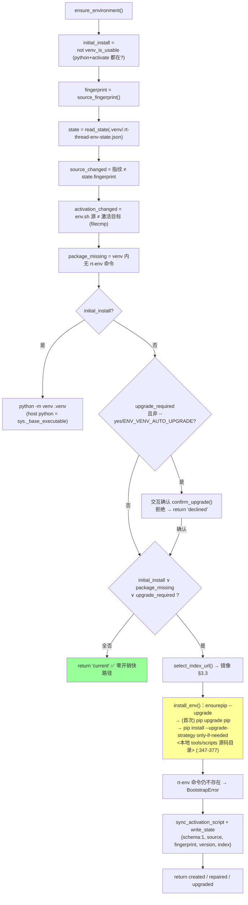

### 3.3 PyPI 镜像三级决策（`select_index_url()`，:265-284）

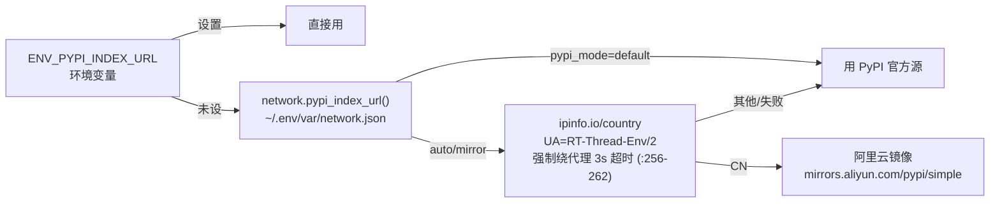

### 3.4 自举状态机

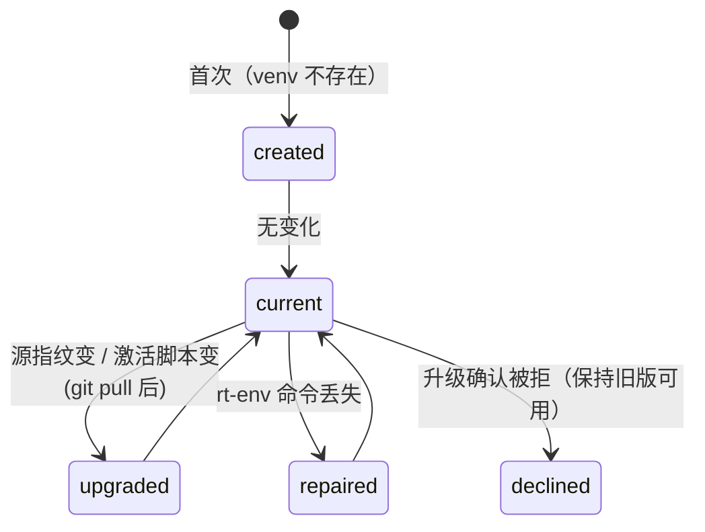

---

## 4. menuconfig 数据流：一条 `.config`，两个消费者

### 4.1 配置生成与分流

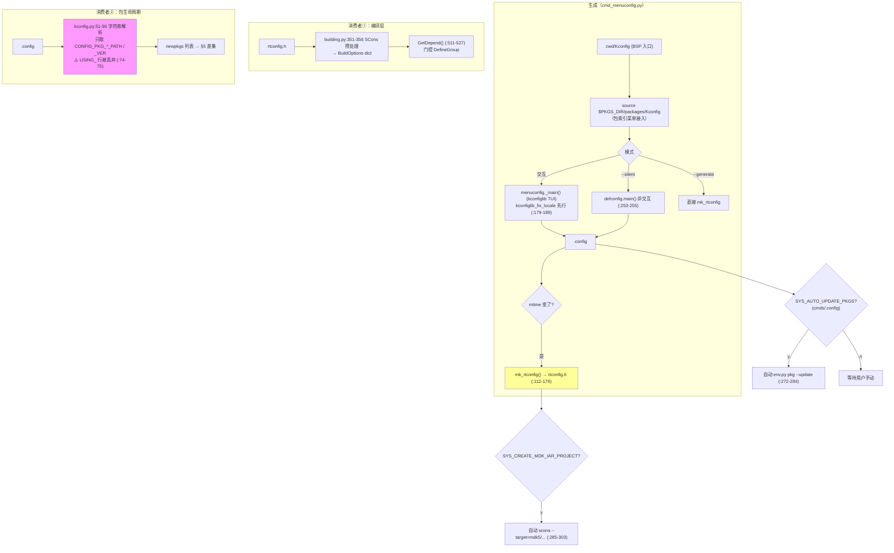

**设计要点**：`.config` 是唯一事实源，但派生两条独立消费链——`rtconfig.h`（编译层，走 C 头）与 `newpkgs`（包层，走字符串解析）。两链各自容错（`mk_rtconfig` 过滤 `PKG_*_PATH/_VER`，:160-162）。

### 4.2 `mk_rtconfig()` 转换规则速查

| `.config` | `rtconfig.h` |
|---|---|
| `CONFIG_FOO=y` | `#define FOO 1` |
| `CONFIG_FOO=123` | `#define FOO 123` |
| `# CONFIG_FOO is not set` | `/* FOO is not set */` |
| `CONFIG_PKG_X_PATH/_VER` | （跳过） |
| 目录有 `rtconfig_project.h` | 追加 `#include` |

---

## 5. pkgs 安装流水线（cmd_package_update.py:1200-1288）

### 5.1 差集决策

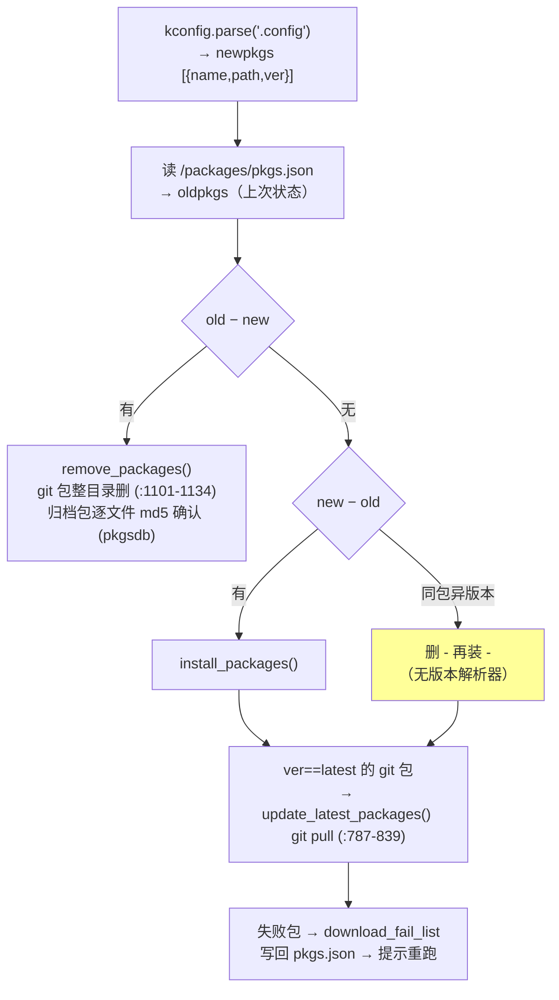

### 5.2 安装双轨（`install_package()`，:614-710）

```mermaid
flowchart TD
    A["package.json site[] 按 ver 匹配<br/>（大小写不敏感，package.py:144-153）"] --> B{"镜像决策<br/>need_using_mirror_download (:430-476)"}
    B -->|命中| C["POST api.rt-thread.org/packages/queries<br/>{userName:RT-Thread, packages:[{name}]}<br/>→ 镜像 site 列表 (cmd_package_utils.py:203-256)"]
    B -->|未命中| D["用原始 URL"]
    C & D --> E{"URL 以 .git 结尾?"}
    E -->|是·git 包| F["install_git_package (:518-574)"]
    E -->|否·归档包| G["install_not_git_package (:577-602)"]

    subgraph F2["git 轨"]
        F --> F1{"目标目录<br/>已存在?"}
        F1 -->|是| F2["⚠️ 直接 return True<br/>幂等跳过不更新 (:534-536)"]
        F1 -->|否| F3["git clone（全量无 depth）"]
        F3 --> F4["set-branches origin <ver_sha><br/>fetch --depth 1 origin <ver_sha><br/>checkout -q <ver_sha>"]
        F4 --> F5["镜像换过 URL → set-url 恢复 origin (:562-566)"]
        F5 --> F6[".gitmodules → 子模块 init"]
    end

    subgraph G2["归档轨"]
        G --> G1["下载 ~/.env/local_pkgs/<filename><br/>重试 5 次 (package.py:217-230)"]
        G1 --> G2["package_integrity_test：<br/>仅 zip/tar 结构校验，无哈希 (archive.py:181-208)"]
        G2 --> G3["解压 package_temp → 顶层改名 <name>-<ver>"]
        G3 --> G4["每个文件 md5 → sqlite<br/>(packages.dbsqlite)"]
    end

    F2 & F6 & G4 --> H2["<bsp>/packages/<name>-<ver>"]

    style F2 fill:#ff9
    style G2 fill:#f99
```

### 5.3 SConscript 桥接与 hal-sdk 双位安装

```
<bsp>/packages/
├── SConscript            ← env 生成（若不存在，package.py:39-51）
│     for item in os.listdir(cwd):
│         if exists(item/SConscript): SConscript(item/SConscript)
│     ⇒ "目录约定"式桥接：包必须自带 SConscript
├── hello-v1.0.0/         ← 普通包：源码直接在此
│   └── SConscript
└── STM32F1-HAL-latest/   ← hal-sdk 包（BSP 有 libraries/ 时）
    └── SConscript        ← 仅桥接脚本，运行时去 libraries/ 找真身
                            (HAL_SDK_BRIDGE_SCONSCRIPT, :62-133)

<bsp>/libraries/STM32F1-HAL-latest/   ← hal-sdk 真实源码
                                      卸载只删桥接、保留源码 (:1155-1163)
```

---

## 6. SDK 与工具链管理

### 6.1 SdkManager plan/apply 两阶段原子应用（sdk_manager.py:940-1088）★

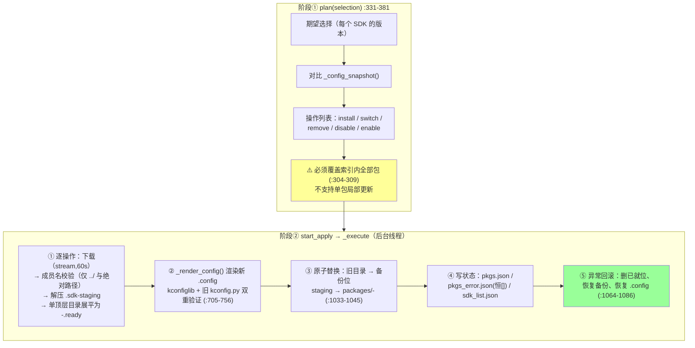

### 6.2 构建侧工具链发现链（rt-thread building.py:246-272）

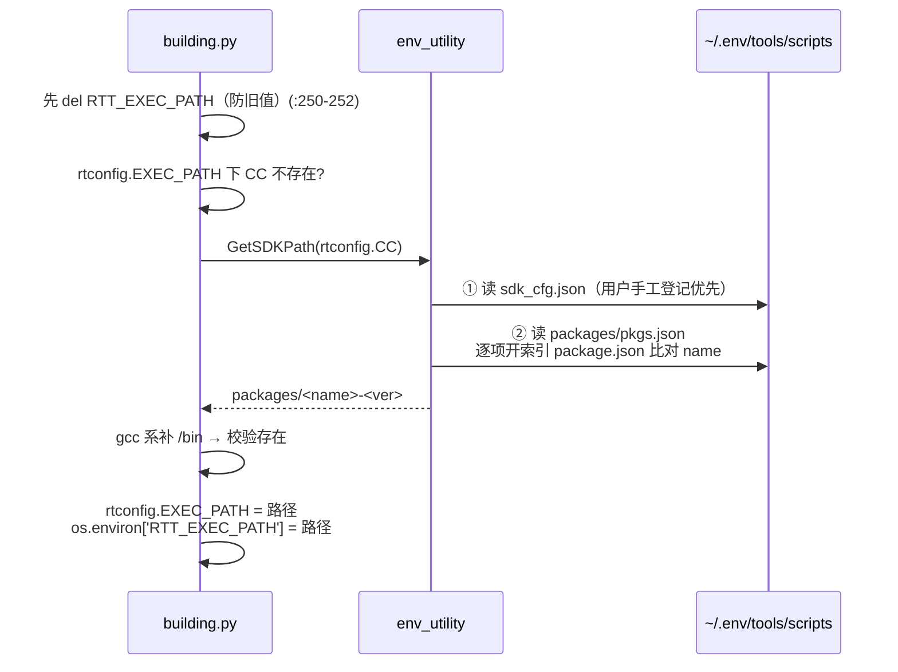

**选择链本质**：`.config`（Kconfig）→ `pkgs.json` → `GetSDKPath` → `RTT_EXEC_PATH`——配置文件是唯一事实源，`sdk_cfg.json` 是用户覆盖通道（ToolchainManager 维护，Windows 下自动扫注册表发现 Keil/IAR，toolchain_manager.py:173-251）。

### 6.3 SDK 索引与安装布局

```
~/.env/
├── packages/sdk/Linux/                  ← 索引（git 仓，按 hostos 分）
│   ├── arm-none-eabi-gcc/
│   │   ├── package.json  {name, site:[{version,URL,filename,size}]}  ⚠️无 sha
│   │   └── Kconfig       PKG_USING_* + 版本 choice
│   └── riscv-none-elf-gcc/ ...
└── tools/scripts/
    ├── .config                          ← SDK 选择落点
    └── packages/
        ├── arm-none-eabi-gcc-v10.3/     ← 实际安装（= 工具链本体）
        ├── pkgs.json                    ← {name(大写), path(索引路径), ver}
        └── .sdk-staging/                ← 原子应用暂存区
```

⚠️ 两个反直觉：SDK 装在 **env 源码仓内**；tarball 下载**无镜像无校验**（Gitee 只加速索引克隆，`sdk_manager.py:764` 直连上游 URL）。

---

## 7. 插件系统与 WebUI

### 7.1 `.epack` 包结构与 CLI 扩展链

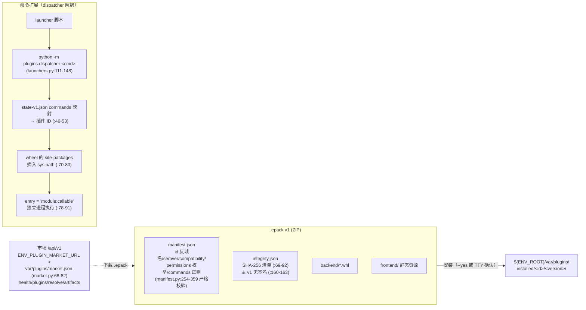

**关键设计**：插件代码永不进入 env 主进程——launcher→dispatcher→独立 wheel 进程。

### 7.2 WebUI BFF 架构与安全模型（plugins/webui/server.py）

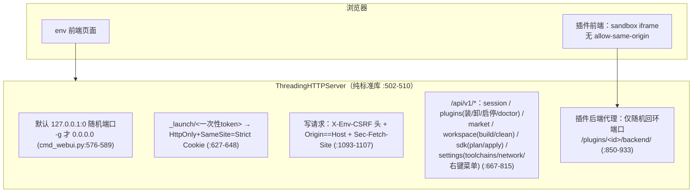

---

## 8. 构建与导出数据流（rt-thread 侧）

### 8.1 统一中间表示（所有导出器的地基）

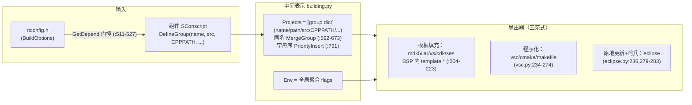

**分工原则**：器件/Flash 算法/调试器等**不可推导**的板级硬信息固定在 BSP 模板；**可推导**的（分组/源文件/头路径/宏）从 Projects/Env 动态注入。

### 8.2 ebuild 与 building.py 的关系（env 仓内的下一代重写）

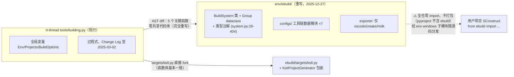

---

## 9. env-windows 引导链（免装机制现场）

### 9.1 启动时序

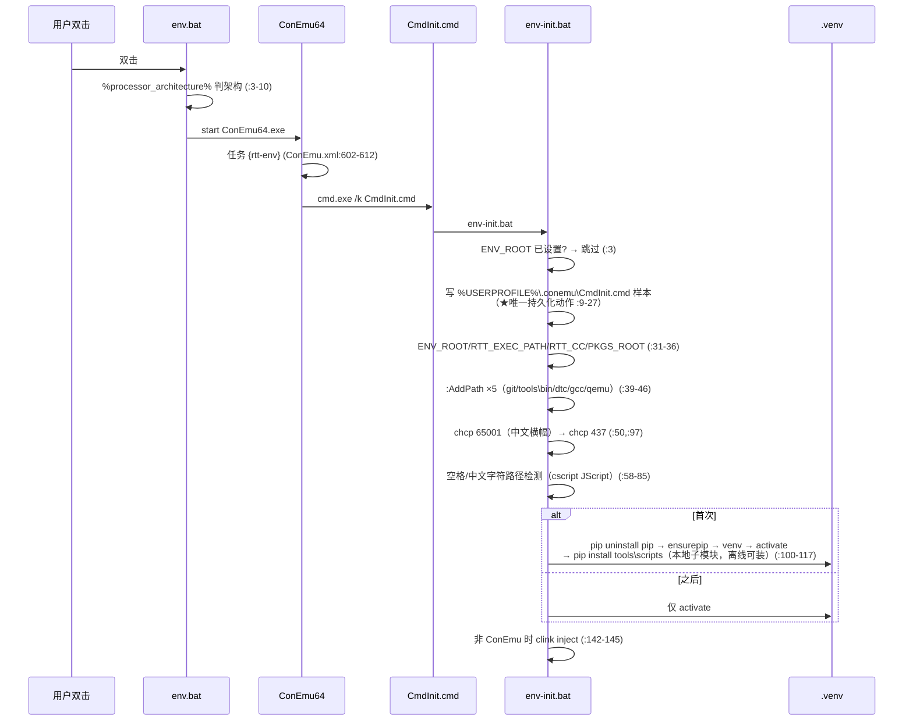

### 9.2 `:AddPath` 去重置顶算法（env-init.bat:123-140）

```
输入 new_path
  ├─ for %%A → %%~fA          相对路径转绝对
  ├─ echo %PATH% | findstr /i /c:"%new_path%;"
  │     未命中 → PATH = new_path;PATH           （前置）
  │     命中   → PATH = new_path;!PATH:new_path;=!（删旧项再前置 ★去重+置顶）
  └─ endlocal & set "PATH=%PATH%"   局部变量回写父进程
```

---

## 10. 设计评价一图流

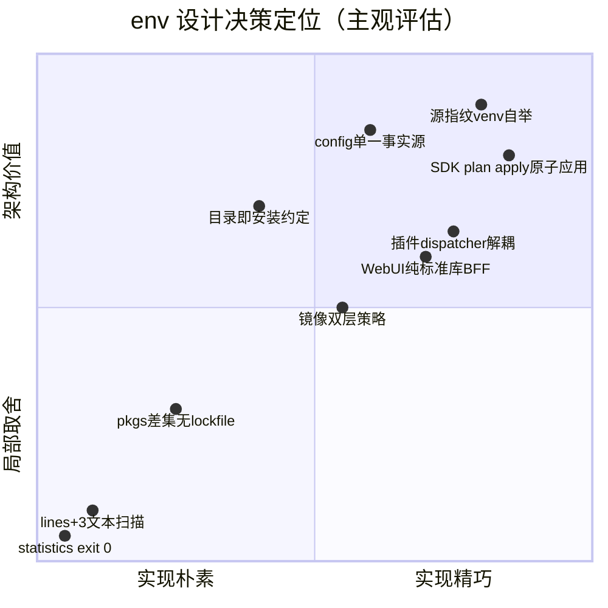

### 亮点

1. **源指纹自举**（§3）：SHA-256(路径+内容) 驱动 venv 状态机，"git pull 即升级"零配置实现，created/repaired/upgraded/current 四态清晰。
2. **SDK 两阶段原子应用**（§6.1）：staging + 备份 + 回滚 + 双重配置验证，env 仓工程质量之最。
3. **`.config` 单一事实源**（§4.1）：人机层/编译层/包层三条消费链从一个文件派生，互不干扰。
4. **Windows 免装四件套**（§9）：便携 Python + venv + 会话级 PATH + 本地 pip 安装，编码/路径防御细节多年踩坑沉淀。
5. **插件进程隔离**（§7.1）：wheel 独立进程 + sandbox iframe + 回环代理，CLI 工具长出 GUI 与插件生态的最低成本路径。

### 不足与 quirks（节选，全表见文字版 §八）

| # | 问题 | 引证 |
|---|---|---|
| 1 | BSP 根=cwd，无 workspace 发现机制 | env.py:209-210 |
| 2 | RTT 根靠 `lines[i+3]` 硬编码偏移，两处重复实现 | env.py:171, cmd_menuconfig.py:65 |
| 3 | pkgs 无 lockfile/依赖解析/多版本共存 | §5.1 |
| 4 | 全链路无哈希校验（包结构校验、SDK 无 sha） | archive.py:181-208, sdk_manager.py:761-855 |
| 5 | statistics 异常 `exit(0)` 杀进程；上报 MAC 默认开启 | statistics.py:62-67 |
| 6 | pkgsdb 路径双重拼接 bug | pkgsdb.py:212-213 |
| 7 | sdk CLI 与 SdkManager 双轨并存不互通 | cmd_sdk.py |
| 8 | ebuild 与 building.py 双轨不收敛，未打包 | §8.2 |
| 9 | env.exe 3.6MB 零引用；touch_env.py 0 字节 | §2 |
| 10 | 插件 v1 无签名，TTY 下未签名自动放行 | cmd_plugin.py:60-63 |

---

## 11. 一页速查（TL;DR）

```
env = venv 自举的 RT-Thread 开发环境工具 + ~/.env 三仓数据目录 + SCons 构建编排约定

  ~/.env/tools/scripts (env 仓 clone)
      │ 源指纹 SHA-256（env_venv.py:113-131）
      ▼
  ~/.env/.venv ← pip install 本地源码（离线可装，git pull 即升级）

  命令面 6 个（pyproject console-scripts）：
      menuconfig → .config ─┬→ rtconfig.h → building.py GetDepend（编译门控）
                            └→ kconfig.py  → pkgs 差集（包生命周期）
      pkgs   → .config 与 pkgs.json 差集 → git(clone/fetch sha/checkout)/归档(无哈希)双轨
               → <bsp>/packages/<name>-<ver> + 桥接 SConscript（hal-sdk → libraries/）
      sdk    → Kconfig 选择 → SdkManager plan/apply（staging+备份+回滚）
               → tools/scripts/packages/<name>-<ver> → GetSDKPath → RTT_EXEC_PATH
      plugin/webui → .epack(ZIP+manifest+sha256清单，无签名) → dispatcher 独立进程
               → WebUI 纯标准库 BFF（localhost+一次性 token+CSRF）

  骨架 ~7800 行：sdk_manager(1134) > cmd_package_update(1288) > env_venv(521)
  两把钥匙：env_venv 的指纹状态机 + cmd_package_update 的差集双轨安装
  最大短板：无 workspace 发现、无 lockfile、无哈希校验、双轨并存
```

---

*本文所有行号基于 env v2.0.2（ec2c251）/ env-windows v2.1.0（fc857c5a）/ rt-thread v5.3.0；文字论证与实操验证见同目录《Env实现机制深度分析.md》。*
