# west 实现机制图解

> 撰写日期：2026-10-09 ｜ 代码基线：west **v1.4.0**（`zephyrproject-rtos/west`，commit `746e1b19`）
> 源码位置：`~/workspace/repo/west`
> 本文是《west实现机制深度分析.md》的**图解配套版**：以图为主重建全部结论，行号引证与文字版一致。
> 图类型：mermaid 流程图 / 时序图 / 类图（VSCode、Typora、GitHub 可直接渲染）+ ASCII ref 空间图。
> 阅读路线：§1 总览 → §2 生命周期 → §3 Manifest（大脑）→ §4 命令层 → §5 扩展机制 → §6 配置 → §7 错误处理 → §8 设计评价。

---

## 1. 总体架构：一张图看懂 west 是什么

### 1.1 分层架构图

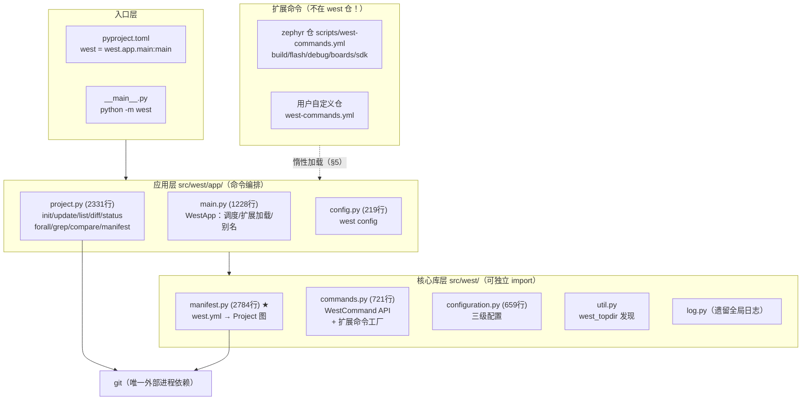

**要点**：
- west 本体 **不含任何构建逻辑**——`west build/flash/debug` 全部是 Zephyr 主仓通过扩展机制注入的（`main.py:1204-1225` 的 `BUILTIN_COMMAND_GROUPS` 里根本没有它们）。
- 核心依赖仅 4 个 Python 包：`colorama / PyYAML / pykwalify / packaging`。
- west = **YAML 声明的多仓拓扑执行器 + git ref 编排器 + 插件运行时**。

### 1.2 三个核心抽象（后文所有图围绕它们）

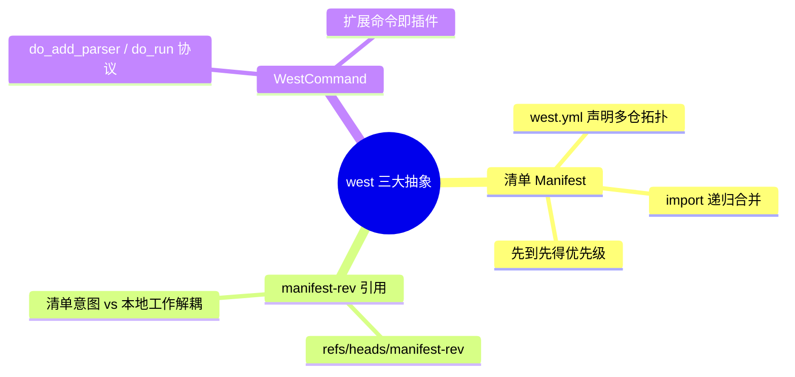

---

## 2. 生命周期：从敲下 `west` 到命令执行

### 2.1 启动分发总流程（`WestApp.run`，main.py:235-278）

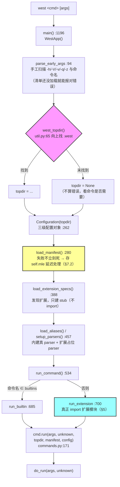

### 2.2 工作区发现算法（`west_topdir`，util.py:65-86）

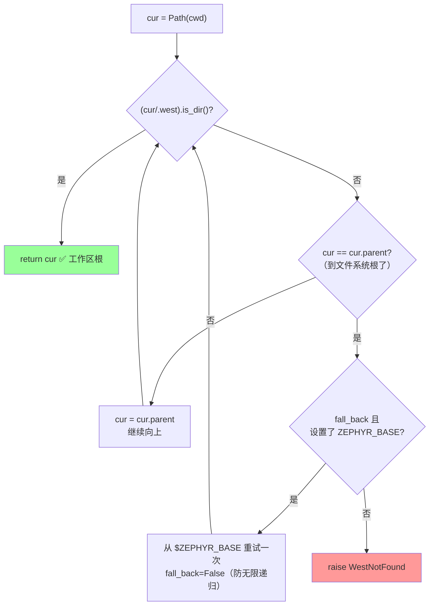

`.west/` 目录里只有两样东西：`config`（记录 `manifest.path`/`manifest.file`）和 init 过程的临时目录。

### 2.3 `WestCommand.run()` 状态注入契约（commands.py:171-200）

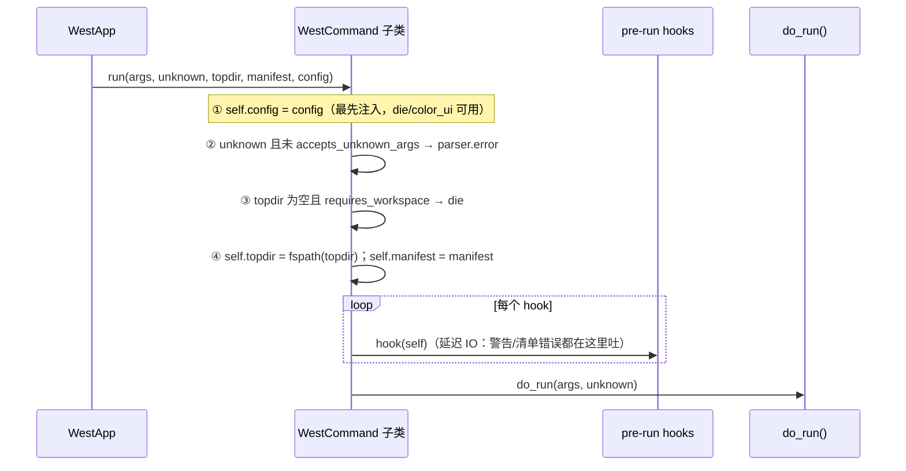

| 子类定制开关                 | 取值    | 使用者                                                                                      |
| ---------------------- | ----- | ---------------------------------------------------------------------------------------- |
| `accepts_unknown_args` | True  | Diff/Status/Grep（多余参数透传给 git/grep）                                                       |
| `requires_workspace`   | False | Init/Config/Help（可在工作区外运行）                                                               |
| `verbosity`            | INF 起 | 全部；`-v/-q` 经 `adjust_command_verbosity`（main.py:1182）平移，`-vvv` 时 `die()` 改抛 RuntimeError |

---

## 3. Manifest 子系统——west 的大脑（manifest.py）

### 3.1 数据模型类图（1.4.0 真实结构）

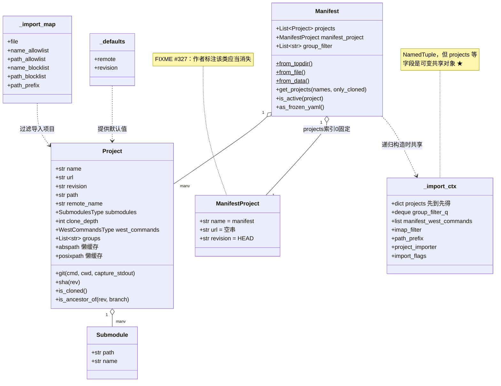

**纠错提示**：此版本**没有** `Remote`/`Defaults`/`Import` 类——remote 只是 `{name: url-base}` 的 dict（manifest.py:2009-2010），defaults/import 分别是 `_defaults`/`_import_map` 两个 NamedTuple。数据模型全部用 NamedTuple，不用 dataclass。

### 3.2 west.yml → 对象的解析流水线

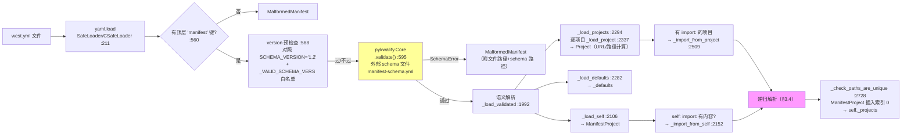

URL 计算的严格优先级（`_load_project` :2351-2377）：

```
url 显式给出 ────────────► 直接用（remote/repo-path 互斥报错）
否则 remote 给出 ────────► url = url_bases[remote] + '/' + (repo-path | name)
否则 defaults.remote ────► 同上（继承默认 remote）
都没有 ─────────────────► MalformedManifest
```

### 3.3 校验的三个"刻意的洞"

| 字段 | schema 声明 | 原因 |
|---|---|---|
| `import` | `type: any` | 递归语义运行时细查（str/list/dict/bool） |
| `submodules` | `type: any` | bool 或 list[dict] 两种形态 |
| `west-commands` | `type: str` | list 只会在 **import 合并时内部产生**，YAML 里直接写 list 会被拒 |

### 3.4 import 递归解析——west 最精巧的算法 ★★★

**机制：递归构造新 Manifest 实例 + 共享同一个可变 `_import_ctx`。**

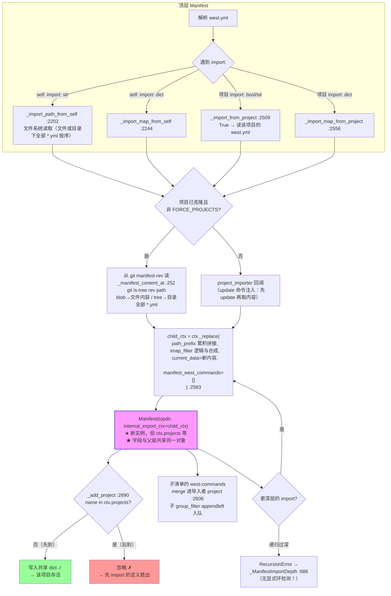

**最终项目顺序**（`_load_validated` :1992-1999 文档明确）：

```
projects[0] = ManifestProject（清单仓自身）
    ↓ 之后依次：
① self: import: 导入的项目      ← 优先级最高
② 本清单 projects: 声明的项目
③ 项目 import: 导入的项目       ← 优先级最低
```

### 3.5 import 过滤器：allow/block 决策图（`_is_imap_ok` :337-353）

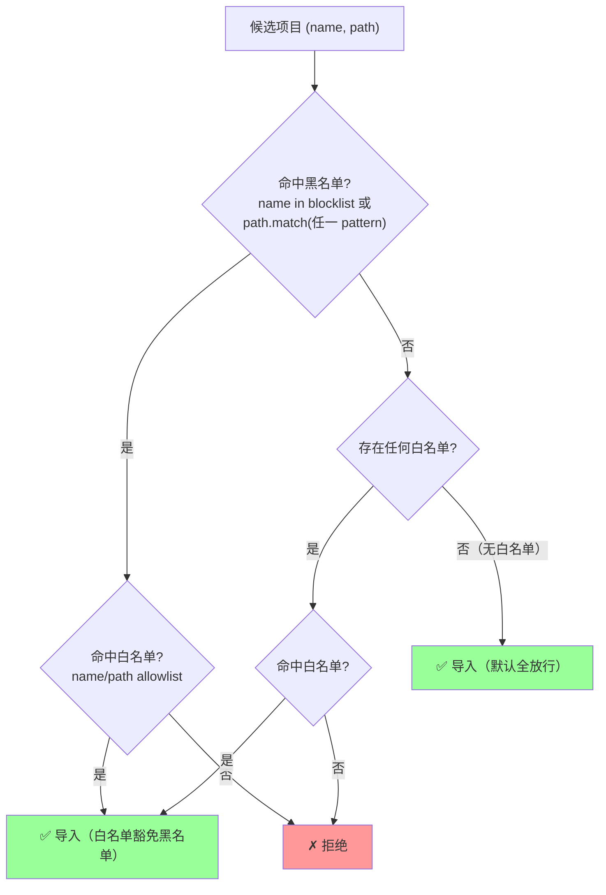

补充规则：嵌套 import 的过滤器做**逻辑与**（`_compose_imap_filters` :434-445）；`path-prefix` 沿 import 链**逐层累积拼接**（:2253, :2585）；旧名 `whitelist/blacklist` 仍兼容（:2643-2655）。

### 3.6 两组过滤机制对比（易混淆）

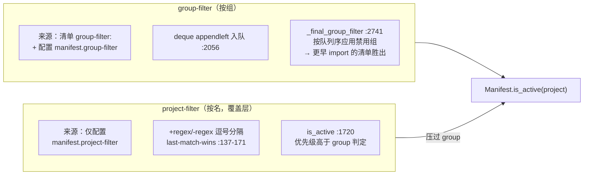

---

## 4. 命令层：init 与 update 的 git 编排

### 4.1 先看灵魂：manifest-rev 解耦模型（ASCII ref 空间图）

west 从不把清单 revision 直接 checkout 到分支。每个项目仓里有**三个互不干扰的空间**：

```
 项目仓（例：zephyr/）的 git ref 空间
 ┌────────────────────────────────────────────────────────────────┐
 │                                                                │
 │  refs/heads/manifest-rev ──► ● C4   「清单意图」                │
 │                                │\         west update 唯一维护   │
 │                                │ ● C5   refs/west/*             │
 │                                │          （fetch 中间态，        │
 │  refs/west/heads/main ──► ● C3 │           用完即删）            │
 │                                │                                │
 │  HEAD (detached) ──────► ● C2  「用户工作」                      │
 │  refs/heads/my-branch ─► ● C1 ─┘       完全归用户                │
 │                                                                │
 └────────────────────────────────────────────────────────────────┘

 west update 时：
   fetch → 写 refs/west/*（SHA 时用 'refs/heads/*:refs/west/*' 全量保存分支）
         → update-ref refs/heads/manifest-rev <目标SHA>   （原子移动意图指针）
         → 逐个删 refs/west/*                              （清理中间态）
   然后基于「用户 HEAD 与 manifest-rev 的祖先关系」决定要不要动工作区（§4.3）
```

**这就是 west 多仓模型不破坏本地工作的根基**：意图（manifest-rev）、中间态（refs/west）、用户工作（HEAD/分支）三者分离。

### 4.2 `west init` 两种模式（project.py:146-413）

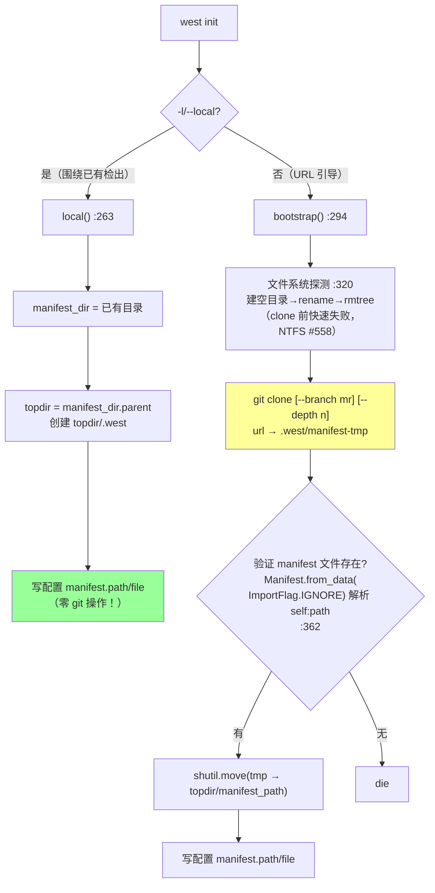

`.west/` 布局：`config`（本地配置）+ `manifest-tmp`（init 临时目录，用完移走）。项目仓的克隆不属于 init，属于 update。

### 4.3 `west update` 每项目 git 序列（project.py:1376-1457）

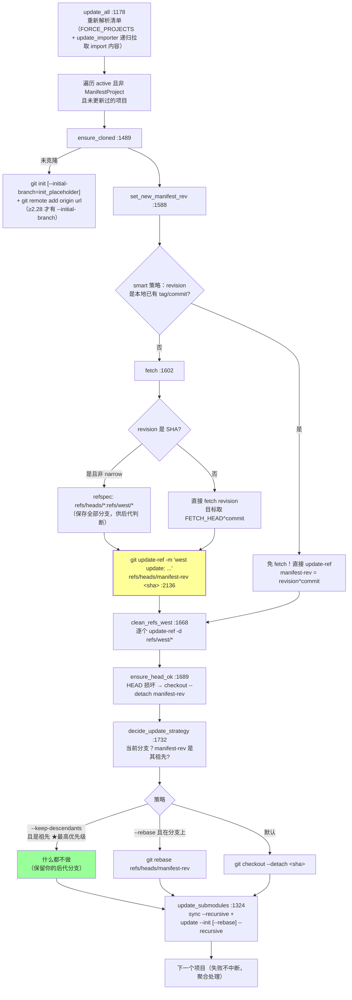

三条关键规则：
1. **update 从不修改清单仓本身**（跳过 ManifestProject，:1196/:1268）。
2. **失败聚合不中断**：逐项目捕获 `CalledProcessError`，跑完全部后 `_handle_failed`（:92-106）统一抛 `CommandError(1)`。
3. **自修复通道**：main.py:316-317 把 `update` 列入 `no_manifest_ok` 白名单——清单本身损坏时仍允许运行 update 来修复（:633-639 专门捕获 `MalformedManifest`）。

### 4.4 其他命令实现速览

| 命令 | 图示要点 | 关键引证 |
|---|---|---|
| `forall` | 串行执行！`Popen(cmd, shell=True).wait()` 朴素循环；注入 `WEST_PROJECT_NAME/PATH/ABSPATH/REVISION/URL/REMOTE` 环境变量 | project.py:1820-1843 |
| `list` | 惰性求值：`sha/cloned/active` 字段用 DelayFormat+thunk，`-f` 没用到就不算 | :483-506 |
| `diff` | `--src-prefix={path}/` 改写前缀；rc=1 **或** rc=0 但有输出都算有差异（兼容 merge-conflict） | :914-978 |
| `status` | 先跑 `git status --porcelain` 0.1s 超时探测，非空才真跑（省时） | :116-144 |
| `compare` | HEAD vs manifest-rev 三重比较：分支名/SHA/dirty；需 git≥2.22 | :752-912 |
| `manifest --freeze` | 每项目解析 manifest-rev 的 SHA，生成可复现清单 | manifest.py:1629-1664 |
| `manifest --untracked` | 顶层目录游走（项目路径排序处理嵌套），列出未跟踪路径 | :681-743 |

**注意**：`forall` 在 1.4.0 **没有并行**；`list` **没有 `--group` 选项**（组过滤经 `is_active` 隐式生效，`-g` 是 forall 的）。

---

## 5. 扩展命令机制：west 的插件运行时 ★

### 5.1 从 west-commands.yml 到可执行命令的全流水线

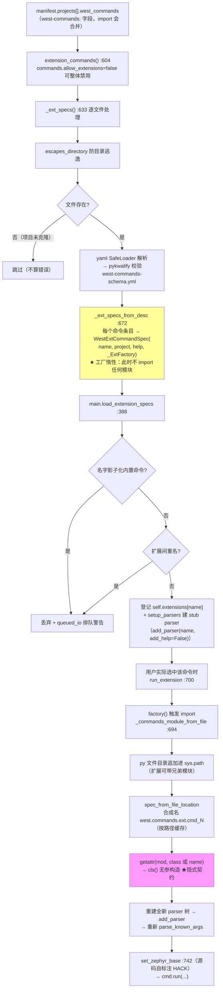

### 5.2 west-commands.yml 的 schema（west-commands-schema.yml:13-37）

```yaml
west-commands:
  - file: scripts/west_commands/build.py   # 必填
    commands:                              # 必填
      - name: build                        # 缺省时 name/class 互为默认
        class: Build                       # 缺省 = name
        help: 编译应用程序                   # 缺省 = "(no help provided; ...)"
```

### 5.3 三态 extensions 与 help 的关系

```
self.extensions 的取值      含义                        west help 表现
─────────────────────────────────────────────────────────────────
None                        清单本身加载失败            "Cannot load extension commands; ..."
{}                          清单正常，但无扩展命令      只列内建命令
{名字: spec, ...}           正常                       按项目分组列出扩展命令
```

`west help <ext-cmd>` 的实现是借道执行 `run_extension(name, [name, '--help'])`（main.py:861-903）。

---

## 6. 配置系统（configuration.py）

### 6.1 三级配置与优先级

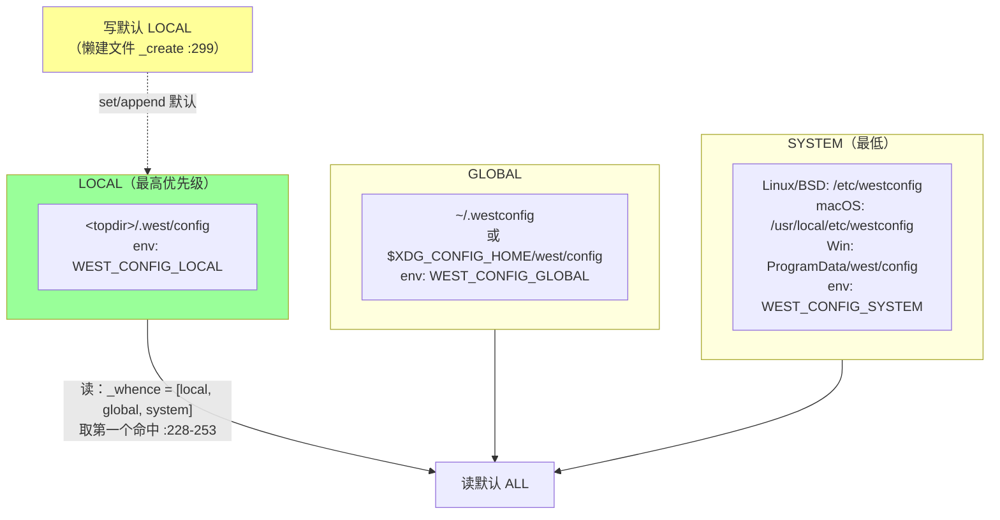

**关键事实**：
- 与 `git config` **零交互**——只借用其"文件位置 + 优先级"惯例，全库无 `git config` 子进程。
- `_InternalCF` 包装 `configparser(allow_no_value=True)`，`section.key` 在首个 `.` 切分；**每次 set 立即全量重写文件**（无事务，多进程并发写会互踩）。
- 读写不对称：**读默认 ALL，写默认 LOCAL**。
- 遗留双轨：`log.py` 全局 VERBOSE（issue #149，v2.0 移除）+ 模块级 `read_config/update_config` 旧 API 发 DeprecationWarning。

---

## 7. 子进程与错误处理

### 7.1 git 调用模式（Project.git，manifest.py:910-974）

```
                    ┌──────────────────────────────────────────┐
  命令构造           │ args = ['git'] + cmd_list + extra_args   │
                    │ （永远是 argv 列表，无 shell！）           │
                    └──────────────┬───────────────────────────┘
                                   ▼
        Popen(args, cwd=项目abspath, stdout/stderr 按需 PIPE)
                                   ▼
     ┌────────────────────────────┴────────────────────────────┐
     │ shlex.quote 的两个真实用途（都只是"显示"）：              │
     │  ① 字符串命令的 shlex.split 预拆（POSIX 规则）           │
     │  ② 日志/错误信息里的人类可读还原 quote_sh_list           │
     └────────────────────────────────────────────────────────┘

  全库唯一 shell=True：forall（它本来就是让用户跑任意 shell 命令的）
```

### 7.2 延迟清单错误——"坏清单也能跑对命令"的机制

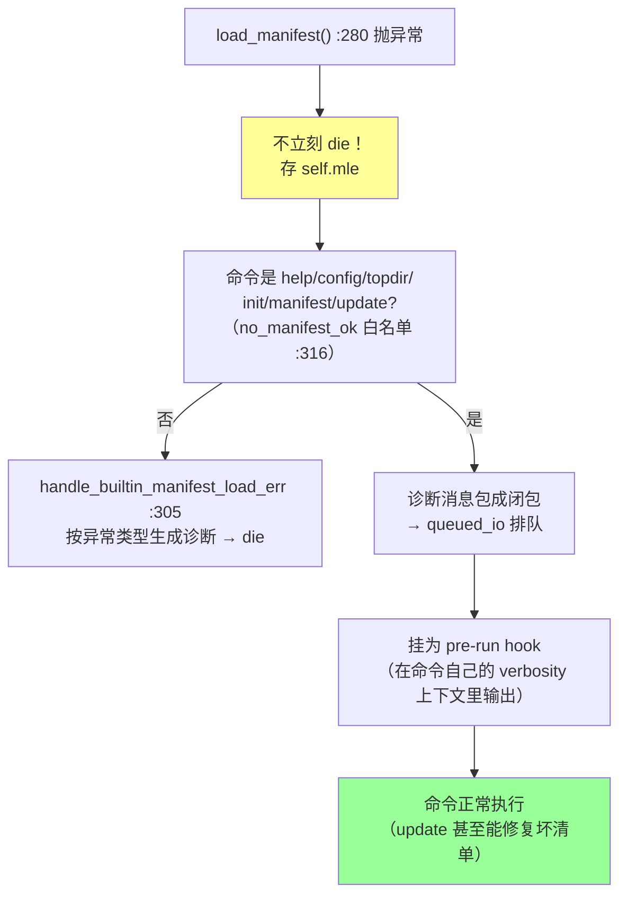

### 7.3 顶层异常 → 退出码映射（main.py:578-641）

```
KeyboardInterrupt     → Windows: exit(0xC000013A - 2**32)
                        POSIX:   恢复 SIG_DFL 后 re-raise SIGINT（还原信号语义）
BrokenPipeError       → exit(0)（配合管道 head 等）
CalledProcessError    → "command exited with status N: <quoted cmd>"，exit(N)
ExtensionCommandError → 消息 + hint；-vvv 打栈，否则落盘 traceback 文件，exit(rc)
CommandError          → 静默 exit(ce.returncode)
MalformedManifest     → cmd.die（update 例外见 §4.3）
WestNotFound          → die
die() 内部            → -vvv 时改抛 RuntimeError（逼出完整栈）
```

部分失败策略（update/status/diff/compare/forall/grep 统一）：**继续跑完 → 末尾聚合 → `CommandError(1)`**。

---

## 8. 设计评价一图流

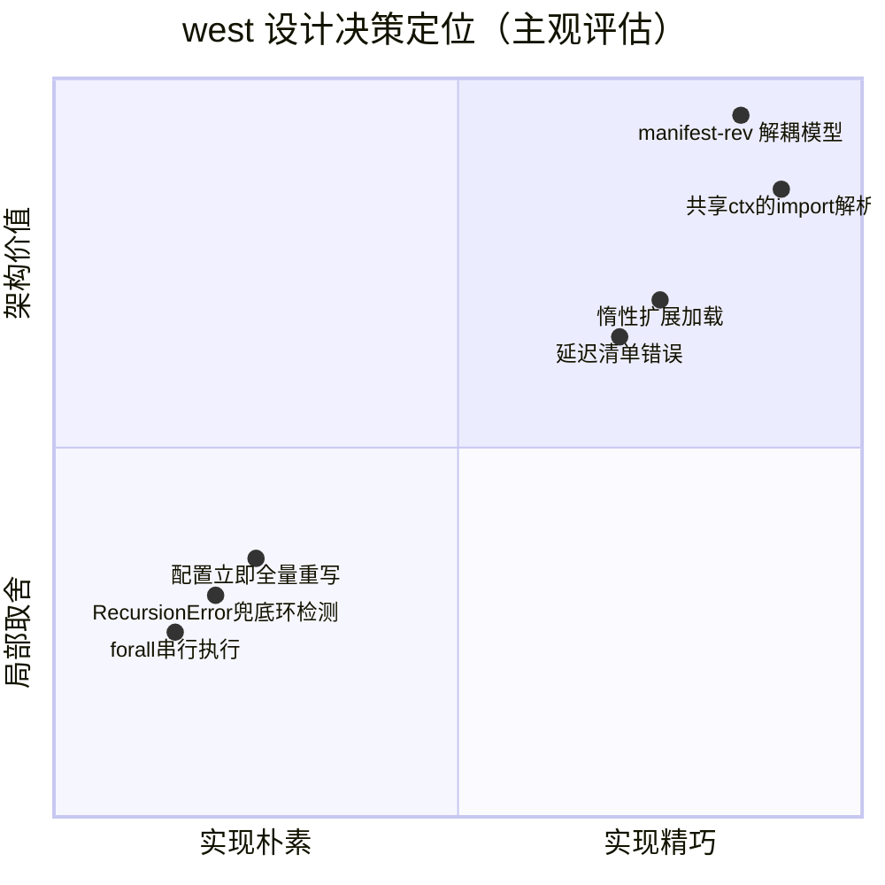

### 亮点

1. **manifest-rev 三空间解耦**（§4.1）：意图/中间态/用户工作分离，`west update` 永不破坏本地工作——整个工具的灵魂。
2. **共享可变 ctx + 先到先得**（§3.4）：三条朴素规则（递归构造、单一 dict、首写胜出）导出全局一致的优先级语义，west-commands 合并与 group-filter 优先级全部对齐。
3. **惰性扩展加载**（§5.1）：stub 占位 → 选中才 import → 重建 parser，大清单下启动开销可控。
4. **工程细节**：init 前文件系统探测、status 0.1s 探测、list thunk 惰性求值、diff 对 merge-conflict 返回码的兼容。

### 不足与 quirks

| # | 问题 | 引证 |
|---|---|---|
| 1 | 无显式 import 环检测，靠 `RecursionError` 兜底（作者自认 hack） | manifest.py:686-688 |
| 2 | `CommandContextError` 定义导出但全库从未 raise | commands.py:62 |
| 3 | `log.py` 全局状态双轨制，v2.0 才清理（issue #149） | log.py:6-20 |
| 4 | `forall` 串行 + `shell=True`（注入面靠文档约束） | project.py:1839 |
| 5 | `ManifestProject` 被标记"该类应当消失"（#327），projects[0] 特判遍布各命令 | manifest.py:1106 |
| 6 | `_commands_module_from_file` 缓存键不一致（查找用 resolve 后路径，写入用原始路径） | commands.py:712/:719 |
| 7 | 配置写为立即全量重写，无并发保护 | configuration.py:105-114 |

---

## 9. 一页速查（TL;DR）

```
west = YAML 声明的多仓拓扑执行器 + git ref 编排器 + 插件运行时

  west.yml ──pykwalify──► Manifest ──import递归(共享ctx,先到先得)──► Project 图
                                                                    │
  west update：fetch → refs/west/* → update-ref manifest-rev → 清理   │
              → keep-descendants/rebase/checkout → submodules        │
                                                                    ▼
  领域命令(build/flash/...)：zephyr 仓 west-commands.yml ──惰性工厂──► WestCommand 插件

  骨架 8300 行：manifest.py(2784) > project.py(2331) > main.py(1228)
  依赖 4 个：colorama / PyYAML / pykwalify / packaging
  两把钥匙：manifest.py 的 import 解析 + project.py 的 update git 序列
```

---

*本文所有行号基于 west v1.4.0（commit 746e1b19）；文字论证与实操验证见同目录《west实现机制深度分析.md》。*
