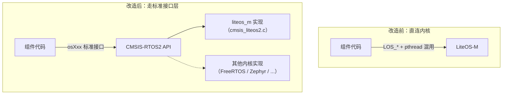
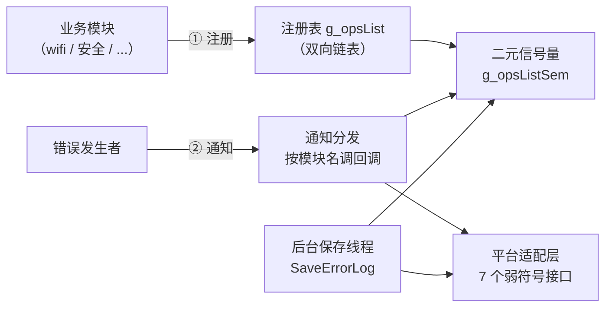
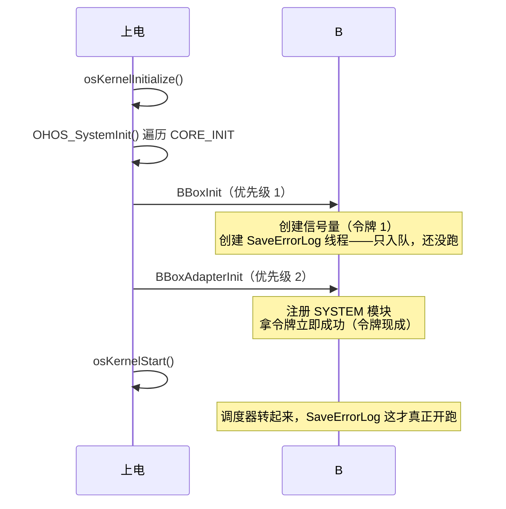
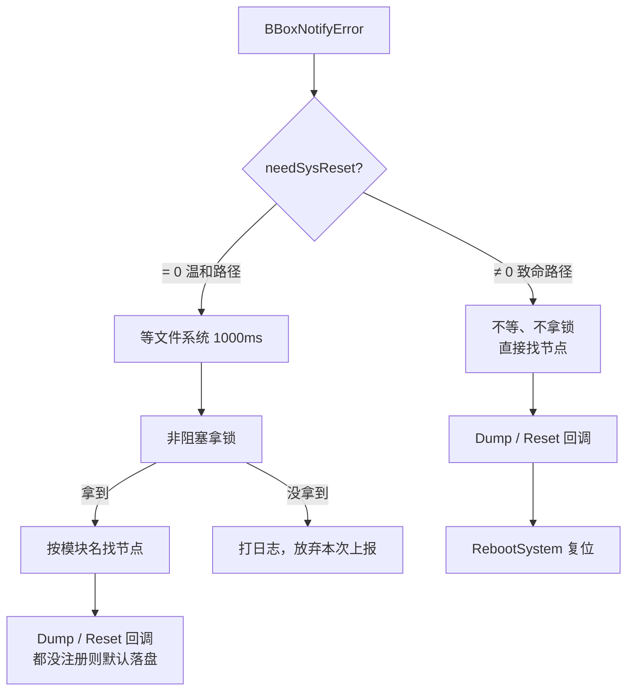

## 需求分析

### 需求背景

**OpenHarmony解决方案为支持多内核需求，切换内核不影响上层服务&框架功能，需要上层部件统一适配CMSIS&POSIX接口，替代使用操作系统原生接口（比如LOS_xx）。**

**分工规则：**

| 系统类型            | 统一使用                      |
| --------------- | ------------------------- |
| small 系统        | POSIX                     |
| mini 系统         | CMSIS-RTOS2               |
| small+mini 共编组件 | 存在分支隔离则分开适配，没有则共用一套 POSIX |

**改造目的：组件代码和具体内核解耦**——无论LiteOS-M或者其他RTOS，只要提供CMSIS-RTOS2实现即可




#### blackbox_lite组件介绍

**blackbox_lite组件**类似黑匣子：

> **当系统或某个模块发生致命错误（panic、看门狗复位、掉电、系统重启）时，在"倒下"之前，把各个模块的关键现场信息（错误事件、模块名、错误描述、各模块自带的诊断数据）收集、保存下来，供事后分析定位问题。**

**使用场景：**

| 场景                 | 行为                                  |
| ------------------ | ----------------------------------- |
| 内核 panic / 系统看门狗复位 | 复位前把各模块的关键寄存器、状态信息 dump 到日志文件       |
| 掉电 / 异常关机          | 保存最后痕迹                              |
| 某个业务模块检测到自身异常      | 调用黑盒接口记录事件，按需触发模块自检（Dump）或重启（Reset） |

**组件逻辑：**



- **注册**：模块想被黑盒"照顾"，先来登记，带上4个诊断回调（Dump / Reset / GetLastLogInfo / SaveLastLog）；
- **通知**：出错 ->  `BBoxNotifyError`，黑盒按模块名找到节点，调它登记时留下的回调；
- **后台保存**：一个一次性线程，启动后把各模块的日志收走存盘上传；
- **锁**：三条路径都碰同一个注册链表，用**一个二元信号量**做互斥。

平台相关的动作（写文件、取日志路径、重启系统……）全部做成**弱符号接口**下沉到适配层——黑盒只管逻辑，怎么落盘平台自己说了算。

这也是本次改造一个关键的观察：**内核接口全部集中在 `blackbox_core.c` 一个源文件里，适配层根本不碰内核**——改动面天然收敛。

数据结构、启动时序、运行场景的细节见文末[[#附录：组件分析]]。

## 适配分析

### 适配过程

整体思路五步：


#### 判断改造形态

见上文——mini-only，单套CMSIS，无分支。**这一步放在最前面**，因为它直接决定后续所有动作的复杂度；如果当初判断错（比如其实有small共编），后面全部返工。

**blackbox_lite组件接口分析**
- **形态判断**：查 `bundle.json`，`adapted_system_type` 只有 `"mini"`
- 使用了LiteOS-M原生接口（信号量、延时等）及pthread接口（线程），两套混用，需要全部替换成CMSIS-RTOS2标准接口。

#### 内核接口盘点

全仓grep内核接口，结果**全部集中在 blackbox_core.c**：

| 类别 | 接口 | 处数 |
|---|---|---|
| 信号量创建 | `LOS_BinarySemCreate` | 1 |
| 信号量等待 | `LOS_SemPend`（阻塞×2、非阻塞×1） | 3 |
| 信号量释放 | `LOS_SemPost` | 4 |
| 延时 | `LOS_Msleep` | 1 |
| 线程创建 | `pthread_create` | 1 |
| 头文件/兜底宏 | `pthread.h`、局部LOS常量定义 | 2 |

另外两处"藏得深"的也要翻出来：两份公开头里抄的3行LOS函数声明（接口污染），以及bundle.json里缺失的第三方依赖声明。**盘点宁可多花十分钟，也不要改到一半发现漏了一处。**

#### 接口一对一映射

6组接口一对一，先列总表再动手：

| 原接口 | 新接口 | 功能 |
|---|---|---|
| `LOS_BinarySemCreate(1, &sem)` | `osSemaphoreNew(1, 1, NULL)` | 创建二元信号量 |
| `LOS_SemPend(sem, LOS_WAIT_FOREVER)` | `osSemaphoreAcquire(sem, osWaitForever)` | 阻塞拿令牌 |
| `LOS_SemPend(sem, LOS_NO_WAIT)` | `osSemaphoreAcquire(sem, 0U)` | 非阻塞拿令牌 |
| `LOS_SemPost(sem)` | `osSemaphoreRelease(sem)` | 还令牌 |
| `LOS_Msleep(ms)` | `osDelay(ms * osKernelGetTickFreq() / 1000)` | 延时 |
| `pthread_create(&tid, NULL, fn, NULL)` | `osThreadNew(fn, NULL, &attr)` | 创建线程 |

替换前先确认过几个"宽心点"，不是拍脑袋就换：

- `osSemaphoreNew` 的 max_count=1 就是二元信号量，而且树内核实现里 max==1 时底层**就是** `LOS_BinarySemCreate`——不是"功能相似"，是同一个内核对象；
- `osWaitForever`（0xFFFFFFFF）和 `LOS_WAIT_FOREVER` 数值一模一样，常数只是从内核头文件搬到了标准头；
- `osOK` 就是0，判错写法 `!= osOK` 和原来的 `!= 0` 完全等价。

#### 改造核心点分析

映射表大部分是机械替换，但有三处不能无脑改——**这三处才是本次改造的核心知识点**：

**1. `osDelay` 的单位是tick，不是毫秒（唯一的"算法级"改动）**

`LOS_Msleep` 传毫秒，`osDelay` 传tick数。同样想延时1秒：

| 接口 | 单位 | 1000Hz内核（WS63） | 100Hz内核 |
|---|---|---|---|
| `LOS_Msleep` | 毫秒 | 传1000 | 传1000（内核自动换算） |
| `osDelay` | **tick** | 传1000 | **传100**（不换算就差10倍） |

所以必须按内核频率换算：

```
tick 数 = 毫秒数 × osKernelGetTickFreq() / 1000
```

频率**现场查询、不写死**——组件才能在1000Hz和100Hz的产品上都精确延时。这是整个改造里最容易踩的坑：在WS63上直接把1000传给osDelay"碰巧是对的"，换到别的产品就错10倍，而且没有任何编译期报错。

**2. 句柄风格：出参式 → 返回值式**

LOS是"返回错误码 + 指针出参写句柄"，CMSIS是"直接返回句柄，NULL判失败"。两种风格无优劣，改代码时把判定从 `!= LOS_OK` 换成 `== NULL` 即可，语义完全一致。

**3. 线程函数签名**

CMSIS规定线程函数签名必须是 `void func(void *)`，原 `SaveErrorLog` 是 `void* func(void *)`——不改会触发编译告警。顺手把原来pthread传NULL的"全默认属性"显式化成 `osThreadAttr_t`（线程名 BlackBoxTask / 栈 0x1000 / 优先级 osPriorityNormal），取值都对齐LiteOS默认，行为不变、可读性更好。

#### 语义时序等价论证

黑盒的初始化跑在 **CORE_INIT阶段——调度器还没启动**。有两个时序问题必须提前论证，不能等跑飞了再查：

- **启动前创建信号量/线程，敢不敢？** 敢。`osThreadNew` 底层是 `LOS_TaskCreate`，调度器没转起来时只是把任务登记进就绪队列，`osKernelStart()` 之后才真正运行——与原来 `pthread_create` 的行为完全一致；
- **启动前调 `osDelay` 会怎样？** 树内核里会退化成空转桩。但本组件的 `osDelay` 只出现在运行时路径（错误通知、后台线程体），CORE_INIT钩子里没人调它，不受影响。

### 适配清单

#### blackbox_core.c

| #   | 位置                  | 原接口                                                    | 新接口                                                                       | 接口说明         | 修改方案                                                                                                    |
| --- | ------------------- | ------------------------------------------------------ | ------------------------------------------------------------------------- | ------------ | ------------------------------------------------------------------------------------------------------- |
| 1   | :19                 | `#include "pthread.h"`                                 | `#include "cmsis_os2.h"`                                                  | POSIX线程头文件引入 | 头文件替换，pthread.h -> cmsis_os2.h                                                                          |
| 2   | :26-28              | LOS_WAIT_FOREVER=0xFFFFFFFF / LOS_NO_WAIT=0 / LOS_OK=0 | osWaitForever / 0U / osOK                                                 | 内核常量复制定义     | 删除 LOS_WAIT_FOREVER / LOS_NO_WAIT / LOS_OK                                                              |
| 3   | :39                 | `static unsigned int g_opsListSem`                     | `static osSemaphoreId_t g_opsListSem`                                     | 信号量句柄类型      | 句柄类型改为CMSIS句柄，unsigned int -> osSemaphoreId_t                                                           |
| 4   | :99                 | `LOS_Msleep(LOG_ROOT_DIR_WAIT_TIME)`                   | `osDelay(LOG_ROOT_DIR_WAIT_TIME * osKernelGetTickFreq() / MS_PER_SECOND)` | 毫秒级任务延时      | 原LOS_Msleep参数为毫秒，osDelay参数为tick数，需要按osKernelGetTickFreq()换算，即tick = 毫秒 * 频率 / MS_PER_SECOND             |
| 5   | :150 / :214         | `LOS_SemPend(sem, LOS_WAIT_FOREVER) != 0`              | `osSemaphoreAcquire(sem, osWaitForever) != osOK`                          | 阻塞等待信号量      | 修改两处，参数LOS_WAIT_FOREVER -> osWaitForever，判断返回值0 -> osOK                                                 |
| 6   | :261                | `LOS_SemPend(sem, LOS_NO_WAIT) != 0`                   | `osSemaphoreAcquire(sem, 0U) != osOK`                                     | 非阻塞等待信号量     | 修改一处，参数LOS_NO_WAIT -> 0U，判断返回值0 -> osOK                                                                 |
| 7   | :177/:225/:234/:294 | `LOS_SemPost(sem)`                                     | `osSemaphoreRelease(sem)`                                                 | 释放信号量        | 修改四处                                                                                                    |
| 8   | :314                | `LOS_BinarySemCreate(1, &sem) != LOS_OK`               | `sem = osSemaphoreNew(1, 1, NULL); 判 NULL`                                | 二元信号量创建      | max_cout参数=1，即设置二元信号量，等价于LOS_BinarySemCreate，LOS是返回错误码+出参句柄，CMSIS直接返回句柄，NULL判断失败，判定由!=LOS_OK -> ==NULL  |
| 9   | :320                | `pthread_create(&tid, NULL, SaveErrorLog, NULL)`       | `osThreadNew(SaveErrorLog, NULL, NULL) == NULL`                           | 后台故障日志保存线程创建 | 线程创建等价替换，CMSIS线程函数标准签名void func(void*)，SaveErrorLog签名void* -> void，return NULL -> return，属性传NULL使用内核默认值 |

#### 公开头与构建

| #   | 位置                           | 原接口                     | 新接口                                                         | 修改方案                                                  |
| --- | ---------------------------- | ----------------------- | ----------------------------------------------------------- | ----------------------------------------------------- |
| 10  | kits/blackbox_adapter.h      | 3 行 LOS_ 内核函数 extern 声明 | /                                                           | 公开头只应声明组件自己的 API，内核声明属于接口污染                           |
| 11  | innerkits/blackbox_adapter.h | 同上                      | /                                                           | 两份头文件保持一致                                             |
| 12  | BUILD.gn :26                 | 无 cmsis 头文件路径           | include_dirs 首位新增 `//third_party/cmsis/CMSIS/RTOS2/Include` | 提供 cmsis_os2.h 搜索路径；放首位保证优先命中；不 dep 树内核（预编译内核产品会被误拉入） |
| 13  | bundle.json :26-27           | `"third_party": []`     | `"third_party": ["cmsis"]`                                  | 依赖元数据补全，纯声明无编译影响                                      |


**组件文件（改造后）**：
- `base/hiviewdfx/blackbox_lite/blackbox_core.c`（核心逻辑）
- `base/hiviewdfx/blackbox_lite/blackbox_adapter.c`（平台适配层）
- `base/hiviewdfx/blackbox_lite/blackbox_detector.c/.h`（上传桩）
- `base/hiviewdfx/blackbox_lite/interfaces/native/kits/blackbox.h`（对外 API + 数据结构）
- `base/hiviewdfx/blackbox_lite/interfaces/native/{kits,innerkits}/blackbox_adapter.h`（平台接口声明）
- `base/hiviewdfx/blackbox_lite/BUILD.gn`、`bundle.json`

**接口参考**：
- CMSIS-RTOS2 标准头：`third_party/cmsis/CMSIS/RTOS2/Include/cmsis_os2.h`
  （osWaitForever:193、osThreadNew:429、osDelay:586、osSemaphoreNew:715、osSemaphoreAcquire:726、osSemaphoreRelease:731）
- 树内核 CMSIS 实现：`kernel/liteos_m/kal/cmsis/cmsis_liteos2.c`（osThreadNew:246、osDelay:643、osSemaphoreNew:1120）
- LiteOS 信号量头：`los_sem.h`（LOS_BinarySemCreate:213、LOS_SemPend:273、错误码 :130/:140）
- LiteOS 基础头：`los_base.h`（LOS_NO_WAIT:84、LOS_WAIT_FOREVER:90、LOS_Msleep:287）


5个文件、13处改动，**业务逻辑零变化**，对外API（`BBoxRegisterModuleOps` / `BBoxNotifyError` / `struct ModuleOps`）零变化——下游无感知：

| 文件 | 改动 | 性质 |
|---|---|---|
| `blackbox_core.c` | 9处接口替换 + 线程签名调整 | 唯一动逻辑的文件（333行→323行） |
| kits / innerkits `blackbox_adapter.h` | 各删3行LOS声明 | 接口清理 |
| `BUILD.gn` | +1行include | 构建接线 |
| `bundle.json` | 补cmsis依赖 | 纯元数据声明 |


编译通过只是底线，这次做了三层验证：

1. **编译**：nearlink_dk_3863（WS63预编译内核产品）build success；
2. **符号**：nm扫描 `libblackbox_lite.a`——`los_` 前缀残留 **0个**；6个os\*符号全部为U（未定义，待内核解析），且预编译内核的固件符号清单里**提前**核实过这6个符号都存在；
3. **头文件命中**：重生成的ninja里 `-I third_party/cmsis` 排在SDK各cmsis副本之前，`cmsis_os2.h` 命中符合预期。

行为层面另有5条等价性论证（信号量同底、P/V同义、延时更准、线程同行为、错误路径逐条保留），评审时逐条过。**"纯接口替换"类改造，等价性是论证出来的，不是测出来的**——这算是一条方法论。

## 结论&PR

[OH master分支PR](https://gitcode.com/openharmony/hiviewdfx_blackbox_lite/pull/28)
[OH 6.1 LTS分支PR](https://gitcode.com/openharmony/hiviewdfx_blackbox_lite/pull/29)

**一句话总结**：mini-only组件的CMSIS适配 = 定范围（单套实现）→ 摸家底（调用点全集中在一个文件）→ 建映射（6组一对一）→ 盯住三处真差异（tick单位/句柄风格/线程签名）→ 论证时序安全 → 符号级验证。真正需要动脑的环节不到两成，剩下的是严谨的体力活。

## 附录：组件分析

#### 数据结构三件

| 结构 | 角色 | 内容 |
|---|---|---|
| `struct ErrorInfo` | 一张"事故报告单" | event / module / errorDesc 三字段 |
| `struct ModuleOps` | 模块的"诊断能力"登记表 | 模块名 + Dump / Reset / GetLastLogInfo / SaveLastLog 四个回调（可NULL） |
| `struct BBoxOps` | 注册表节点 | 链表节点 + ModuleOps |

#### 启动时序



"创建不执行"是理解启动时序的关键：线程创建本质是"登记进就绪队列"，调度器启动前登记了也不会跑。这也是前文"启动前创建线程敢不敢"的答案来源。

#### 三个运行场景



重点体会**三种锁策略的设计意图**：

| 路径 | 拿锁方式 | 为什么 |
|---|---|---|
| 注册 | 阻塞（osWaitForever） | 注册方"不成功不罢休"，值得等 |
| 后台保存 | 阻塞 | 专职干活，排队就好 |
| 错误通知（温和） | 非阻塞（0超时） | 报错的人不能被锁卡住排队——宁丢一次上报，不堵死报错者 |
| 错误通知（致命） | 不拿锁 | 系统马上要复位，抢时间保现场第一，锁破坏了也无所谓，有意取舍 |

#### 文件地图

| 文件 | 职责一句话 |
|---|---|
| `blackbox_core.c` | 核心逻辑：注册表、通知分发、后台保存线程（本次改造唯一动逻辑的文件） |
| `blackbox_adapter.c` | 平台适配层：7个弱符号接口默认实现 + 启动注册SYSTEM模块 |
| `blackbox_detector.c/.h` | 事件上传桩（预留接口） |
| `interfaces/native/kits/blackbox.h` | 对外API + 数据结构 |
| `interfaces/native/{kits,innerkits}/blackbox_adapter.h` | 平台接口声明（两份副本同步维护） |
| `BUILD.gn` / `bundle.json` | 构建脚本 / 组件元数据 |
