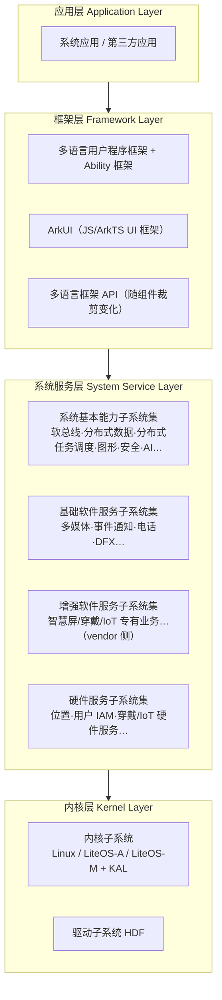
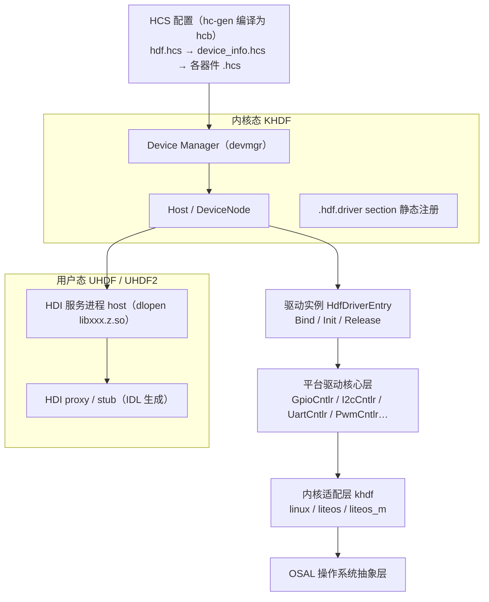
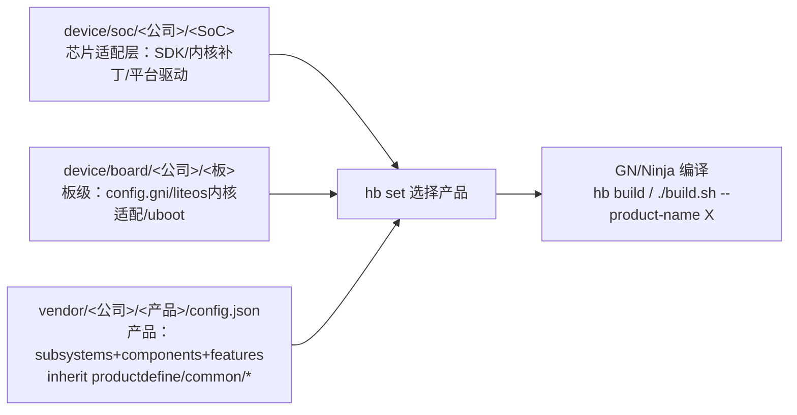

# OpenHarmony 系统深度调研报告（海思适配视角）

> 调研时间：2026-11-02 · 方法：多 agent 饱和调研（9 轴并行 + 1 扩展波，均带一手来源核验）
> 目的：为「OpenHarmony 在海思芯片上适配」的工作建立系统级认知基础
> 阅读提示：关键数字均标注来源与统计时点；【冲突】标记官方文档间的口径分歧；【纠错】标记对常见误解的澄清

## 目录

1. 执行摘要
2. 项目概况与版本演进
3. 系统架构总览
4. 内核体系
5. 子系统全景
6. HDF 驱动框架
7. 编译构建体系与设备开发流程
8. 应用开发框架与分布式能力
9. 海思芯片适配专题
10. 调研方法论与来源

---

## 执行摘要

**OpenHarmony 是什么**：由开放原子开源基金会（OpenAtom Foundation）孵化及运营的开源操作系统项目（Apache-2.0），华为 2020-09-10 捐赠初始代码，此后由社区共同演进。它面向全场景、多设备形态，采用多内核设计，通过分布式软总线等能力实现设备间协同。HarmonyOS 是华为基于 OpenHarmony 开发的**商用发行版**（闭源，含 HMS/AppGallery 等专有服务），二者是「开源底座 vs 商业发行版」的关系（基金会 2026-08 官方声明专门厘清边界）。 [S10]

**版本现状（截至 2026-11-02，均已一手核验）**：
- 最新功能版本：**OpenHarmony 7.0 Release（2026-08-22，API 26.0.0）**，API 版本号自 7.0 起采用 SemVer； [S2]
- 最新 LTS：**6.1 LTS（2026-07-31，API 23）**；最新代码标签 v6.1.1-LTS（2026-10-31，仅含 cve-fix 合入、无 release note，属维护/安全标签）；
- 发布节奏：每年 Q1、Q3 各一个 Release；LTS 生命周期 3.5 年（2+1.5）。

**对海思适配最重要的五个事实**：
1. **代码托管已于 2025-09-16 整体从 Gitee 迁移至 GitCode**（`gitcode.com/openharmony`），Gitee 为停滞只读镜像（build 仓停在 2025-09-12，无 7.0 分支/标签）。取代码、提 patch 一律以 GitCode 为准； [S3]
2. **不存在单体 monorepo**：源码由 repo 工具 + `manifest` 仓的 XML 清单组装（master 共 515 个平台仓），「子系统→仓」靠 `build/subsystem_config.json` + 各仓 `bundle.json` + `vendor/<厂商>/<产品>/config.json` 三层映射；
3. **标准系统默认内核已是 linux-6.6**（自 5.1.0 起，`build/ohos/kernel/kernel.gni`），4.19 仅维护、5.10 与 6.6 并存按板选择；板级补丁在**独立仓 `kernel_linux_patches`**（`kernel/linux/patches/linux-{5.10,6.6}/<板名>_patch`）；
4. **Hi3516DV300 的「标准系统」参考板地位已于 3.2 版本终止**（官方原文建议改用 RK3568），但其**小型系统**（LiteOS-A/Linux）仍是列名参考板并持续发布镜像至 7.0；Hi3861（轻量）仍是官方一等公民；
5. **海思 2025-2026 的新官方主线是 Hi3403V100/Hi3519AV200**（开发板 hispark_aifly，官方适配套件基于 OpenHarmony 5.1.0 Release + Linux 6.6.86 的 Small 系统、支持 XTS）：2025-11 架构 SIG 批准建仓孵化，**代码已于 2026-09-01 合入主线三仓**，主线版本已可基于 **OpenHarmony-6.1-LTS 直接编译（无需打补丁）**。这是「新海思 SoC 上 OpenHarmony」的现行完整模板（详见 9.4/9.7）。

**适配新海思 SoC 的技术面** = Bootloader（U-Boot + ATF BL33）→ 内核（Linux 6.6 + SDK patch 合流）→ HDF 平台驱动/器件驱动（GPIO/I2C/SPI/UART/PWM…+ HDI）→ 三级产品配置（device/soc + device/board + vendor）→ init 配置 → XTS 验证。详见第 9 章。 [S7]

> 本节来源：[S2] [S3] [S9]

---

## 项目概况与版本演进

### 2.1 定位与治理

- **托管与许可**：开放原子开源基金会孵化及运营，Apache-2.0 许可。官网自述：「由开放原子开源基金会（OpenAtomFoundation）孵化及运营的开源项目」（www.openharmony.cn，访问 2026-11-02）。 [S10]
- **里程碑**：2020-09-10 华为签署捐赠协议捐出基础代码；2020-12-22 七家单位（倍益康、华为、京东、润和、亿咖通、中科院软件所、中软国际）成立 **OpenHarmony 项目群工作委员会**，重大事项「一家单位一票」平等表决；治理架构 = 工作委员会 → TSC（技术委员会）/ PMC / 安全委员会 / 兼容性工作组 → 72 个 SIG（2026-11-02 官网 API 口径）。
- **毕业**：2025 年成为开放原子首批「毕业项目」之一（基金会 2026-08-28 文章回顾）。

### 2.2 与华为 HarmonyOS 的关系

| | OpenHarmony | HarmonyOS |
|---|---|---|
| 属性 | 基金会托管的开源项目 | 华为商用发行版（闭源） |
| 许可 | Apache-2.0 | 专有 |
| 典型承载 | 各厂商发行版（KaihongOS、HiHopeOS 等 100+） | 华为设备 |
| 关系 | 开源底座 | 基于 OpenHarmony 技术底座发展（HarmonyOS 7 / API 26 基于 OpenHarmony 7.0，2026-09-06 商用发布） |

基金会 2026-08-28 官方文章原话：「厘清开源鸿蒙（OpenHarmony）与基于开源鸿蒙技术底座发展的商用鸿蒙操作系统（HarmonyOS）的边界」（openatom.cn，访问 2026-11-02）。

> 【纠错】常见说法「OpenHarmony 是 HarmonyOS 的开源版」不准确：华为捐出的是基础能力，社区独立演进，HarmonyOS 再从基金会取码叠加专有能力；两个代码线非同步关系。此外 HarmonyOS 商用 API 版本与 OpenHarmony 存在错位（如 HarmonyOS 6.1.1 = API 24，而 OpenHarmony 6.1 = API 23），不要直接划等号。 [S2]

### 2.3 版本时间线（全部来自 docs 仓 release-notes 索引，GitCode master，访问 2026-11-02）

| 版本                    | 发布日期                                 | API          | 备注                                           |
| --------------------- | ------------------------------------ | ------------ | -------------------------------------------- |
| 1.0                   | 2020-09-10                           | —            | 初始捐赠版                                        |
| 1.1.0 LTS             | 2021-04-01                           | —            | 首个 LTS                                       |
| 2.0 Canary            | 2021-06-01                           | —            | 引入标准系统（Linux）                                |
| 2.2 Beta2             | 2021-07-30                           | 6            | 分布式能力起步                                      |
| 3.0 LTS               | 2021-09-30                           | 7            |                                              |
| 3.1 Release           | 2022-03-30                           | 8            |                                              |
| 3.2 Release           | 2023-04-09                           | 9            | **Hi3516DV300 标准系统适配验证终止于本版**                |
| 4.0 Release           | 2023-10-26                           | 10           |                                              |
| 4.1 Release           | 2024-03-30                           | 11           |                                              |
| 5.0.0 Release         | 2024-09-29                           | 12           | 默认内核仍 5.10                                   |
| 5.0.1 / 5.0.2 / 5.0.3 | 2024-11-22 / 2025-01-22 / 2025-03-21 | 13 / 14 / 15 | 5.0 补丁线                                      |
| 5.1.0 Release         | 2025-04-30                           | 18           | **默认内核切换 linux-6.6 的起点**；Hi3403 官方适配套件所基于的版本 |
| 6.0 Release           | 2025-09-06                           | 20           | **代码托管迁移 GitCode 前最后一个 Release**             |
| 6.0.0.1 / 6.0.0.2     | 2025-12-23 / 2026-03-24              | 20           | 6.0 补丁线                                      |
| 6.1 Release           | 2026-03-08                           | 23           | hispark_pegasus_3863 镜像自此版出现                 |
| 6.1 LTS               | 2026-07-31                           | 23           | 当前 LTS，维护 3.5 年                              |
| 7.0 Release           | **2026-08-22**                       | **26.0.0**   | 最新功能版本；API 版本号改用 SemVer                      |
| （v6.1.1-LTS 标签）       | 2026-10-31                           | —            | 仅 cve-fix 合入，无 release note，维护/安全标签          |

7.0 主要内容（7.0 release note，GitCode docs）：P7885 参考板、Chromium 144（ArkWeb）、ModularObjectExtensionAbility、统一 SDK、压缩模块等。 [S2]

### 2.4 发布节奏与 API 编号

- 节奏：每年 Q1、Q3 各发布一个 Release 版本；LTS 每两年一个（6.1、规划的 8.1），Release 分支维护 2 年（1+1）、LTS 3.5 年（2+1.5）（release-management 生命周期文档）。 [S2]
- API 编号随版本递增但**不连续**（5.0.3=15 → 5.1.0=18 → 6.0=20 → 6.1=23 → 7.0=26），跳号属正常现象，官方未解释空缺区间；自 API 26.0.0 起版本号采用 SemVer（X.Y.Z）格式。 [S2]

### 2.5 社区规模（MEASURED，每个数字附统计时点）

| 指标                      | 数值                                                 | 统计时点                    | 来源口径                     |
| ----------------------- | -------------------------------------------------- | ----------------------- | ------------------------ |
| 代码贡献者                   | 13,960                                             | 2026-08-31              | 社区运营数据（界面新闻）             |
| 代码贡献者                   | 13,808                                             | 2026-08-28              | 基金会理事长演讲（openatom.cn）    |
| DCO 签署邮箱                | 14,309                                             | 2026-11-02 抓取           | 官网计数器（标注为「代码贡献者」）        |
| 官网 API contributorCount | 10,496                                             | 2026-11-02 抓取           | 与上项口径不一致，须区分             |
| 社区伙伴                    | 671                                                | 2026-08-31              | 界面新闻                     |
| 兼容性测评产品                 | 2,082                                              | 2026-08-31              | 界面新闻                     |
| 合并请求 PR                 | 919,867                                            | 2026-11-02 抓取           | 官网统计 API                 |
| SIG 数                   | 72                                                 | 2026-11-02 抓取           | 官网统计 API                 |
| 代码规模                    | 1.4 亿行+                                            | 2026-08-31              | 界面新闻 / China Daily       |
| 仓库                      | 515 平台仓（manifest master）/ 537 去重 / 三组织 2,245+ 公开项目 | 2026-11-02 / 2025-12-31 | manifest 实测 / AtomGit 新闻 |
| 商业发行版                   | 91（54 家厂商）→ 100+                                   | 2026-01-06 → 2026-06-17 | CNMO / 证券时报              |
| 生态设备                    | 13.5 亿台                                            | 2026-08-28              | 中新网/基金会                  |

> 官网「贡献者」计数（14,309）实为 DCO 签署邮箱数，与统计 API 的 contributorCount（10,496）口径不同。引用社区数据时务必带时点与口径。 MEASURED [S10]

### 2.6 代码托管迁移（对适配工作有直接影响）

2025-09-16 社区完成 Gitee→GitCode 整体迁移（GitCode 官方公告：「已于2025年9月16日正式完成从Gitee到GitCode平台的整体迁移。原Gitee站点将作为镜像继续提供只读服务」）。实测（2026-11-02）：
- `manifest` master：GitCode 1784235（2026-10-30，活跃）vs Gitee 88874af（2026-04-24，停更）；
- `build` 仓 master：Gitee 停在 2025-09-12，且 Gitee 端**没有** OpenHarmony-7.0-Release 分支/标签；GitCode weekly tag 更新至 20261102； [S3]
- 官方《获取源码》文档（docs master `sourcecode-acquire.md`）当前只写 `repo init -u https://gitcode.com/openharmony/manifest.git`。

**结论：克隆、提 patch、查最新代码一律走 GitCode；Gitee 只可作历史快照参考（其内容对 6.0 及以前版本仍有效）。** [S3]

> 本节来源：[S2] [S10]

---

## 系统架构总览

### 3.1 官方分层架构

依据 `docs` 仓 `zh-cn/OpenHarmony-Overview_zh.md`（master，SHA b847798*，访问 2026-11-02）：「OpenHarmony整体遵从分层设计，从下向上依次为：内核层、系统服务层、框架层和应用层」。



四子系统集官方名称（Overview L22-L33，**注意不是「基础能力子系统集」**）：
1. **系统基本能力子系统集**：分布式软总线、分布式数据管理、分布式任务调度、公共基础类库、多模输入、图形、安全、AI 等；
2. **基础软件服务子系统集**：事件通知、电话、多媒体、DFX 等通用服务；
3. **增强软件服务子系统集**：智慧屏/穿戴/IoT 专有业务（开源主干中仅 `domains/` 下少量仓，主体由厂商 vendor 侧实现）；
4. **硬件服务子系统集**：位置服务、用户 IAM、穿戴/IoT 专有硬件服务等。

裁剪规则：子系统集内可按子系统粒度裁剪，子系统内部可再按功能粒度裁剪；「统一 OS、弹性部署」覆盖 ARM/RISC-V/x86、百 KiB 到 GiB 级 RAM。

> 【滞后】应用层描述在 Overview 中仍写 FA/PA（旧 FA 模型概念），而现行应用开发已是 Stage 模型（UIAbility/ExtensionAbility）。架构文档落后于应用模型演进，阅读官方架构文档时注意。

### 3.2 分布式能力地图（架构级）

| 能力              | 层位/定位         | 一句话职责                                    | 关键仓（Gitee/GitCode 同名）                                                                               |
| --------------- | ------------- | ---------------------------------------- | --------------------------------------------------------------------------------------------------- |
| 分布式软总线 DSoftBus | 系统服务层·统一通信基座  | 与链路无关的设备发现/连接/组网/传输，设备内 IPC 与设备间 RPC 统一  | communication_dsoftbus                                                                              |
| 分布式数据管理         | 软总线之上         | 数据与物理设备解绑：KV/RDB 同步、分布式数据对象、UDMF         | distributeddatamgr_*（kv_store/relational_store/data_object/datamgr_service）                         |
| 分布式任务调度         | 系统服务层（dmsfwk） | 统一分布式服务管理（发现/同步/注册/调用）：远程启动/调用/绑定/**迁移** | ability_dmsfwk（dtbabilitymgr/dtbschedmgr）+ systemabilitymgr（samgr/safwk）                            |
| 分布式硬件           | 系统服务层         | 基于 **HDI** 的硬件资源池化+虚拟硬件实例（相机/屏幕/音频/输入）   | distributedhardware_{device_manager,distributed_hardware_fwk,distributed_camera/screen/audio/input} |
| 跨端流转 HOP        | 框架/应用层        | 跨端迁移 + 多端协同（跨多设备分布式操作统称「流转」）             | docs: inter-device-interaction-hop-overview                                                         |

关键约束（移植/开发前须知）：
- 软总线要求设备在同一局域网（docs 明文约束）；跨设备通信须先完成设备绑定认证，且需要 `DISTRIBUTED_DATASYNC` 等权限；
- **同帐号设备互信认证未开源**（security 子系统 README 明示 stub）、分布式应用权限管理未开源。纯 OpenHarmony 发行版上跨端体验依赖厂商自行补齐；
- 跨端迁移由系统应用触发（三方应用无法直接发起），多端协同任务管理不向三方开放（docs hop 系列原文）。

### 3.3 系统形态与硬件基线

| 形态            | 处理器                       | 官方 RAM 基线（开发文档口径） | 可用内核           | 典型设备              |
| ------------- | ------------------------- | ----------------- | -------------- | ----------------- |
| 轻量系统 mini     | MCU（Cortex-M、RISC-V 32 位） | **128KiB**        | LiteOS-M       | 连接模组、传感器、穿戴       |
| 小型系统 small    | 应用处理器（Cortex-A，带 MMU）     | **1MiB**          | LiteOS-A、Linux | IP Camera、电子猫眼、路由 |
| 标准系统 standard | 应用处理器                     | **128MiB**        | Linux          | 带屏 IoT、轻智能机       |

> 【冲突·三口径】硬件基线在官方体系内有三套口径，引用时必须注明出处：
> ① 开发文档族（Overview/device-dev-guide/kernel-overview/quickstart）：128KiB / 1MiB / 128MiB（仅 RAM）；
> ② 《产品兼容性规范》3.1：小型系统 **≥4MiB（且要求 MMU）**、标准系统 128MiB（措辞为「**建议**」），并给出存储基线：轻量 ≥2MiB NVM（用户可读 ≥128KiB）、小型 ≥16MiB、标准 ≥2GiB； [S10]
> ③ 团体标准 T/TJIMEIA 001-2022：按 <4MiB / 4-512MiB / >512MiB 三档分级。
> 开发口径与认证口径用途不同（前者=「能跑起来」，后者=「能过兼容性认证」），做芯片选型时建议按兼容性规范口径预留余量。

### 3.4 安全与 DFX（概览级）

- 安全架构六维：硬件安全、系统安全、数据安全、设备互联安全、应用安全、安全更新（security-guidelines-overall.md）；
- DFX 组件按系统形态分级适用（subsys-dfx-overview.md 给出轻量/小型/标准各自的组件与内存基线表）：HiLog/HiTraceChain/HiTraceMeter/HiSysEvent/HiDumper/Faultloggerd/HiView/HiAppEvent/HiCollie 等。

> 本节来源：[S1]

---

## 内核体系

### 4.1 总览：多内核 + KAL

OpenHarmony 是**多内核**系统：LiteOS-M（轻量）、LiteOS-A（小型）、Linux LTS（小型+标准），上层通过 **KAL（Kernel Abstract Layer）** 屏蔽差异（覆盖进程/线程、内存、文件系统、网络、外设管理）。驱动侧由 HDF + OSAL 承担跨内核职责（见第 6 章）。

| 系统级别 | 轻量 | 小型 | 标准 |
|---|---|---|---|
| LiteOS-M | ✔ | ✘ | ✘ |
| LiteOS-A | ✘ | ✔ | ✘ |
| Linux | ✘ | ✔ | ✔ |

> 【冲突·两口径】子系统 README 的粗表写「LiteOS=轻量+小型」，开发指南细表（上表）为 M/A/Linux 分工；以细表与代码能力为准。

### 4.2 LiteOS-M（轻量系统内核）

- 定位：「面向IoT领域构建的轻量级物联网操作系统内核，具有小体积、低功耗、高性能」（kernel_liteos_m README_zh）；
- 四层结构：arch（硬件相关，按「架构/工具链」二维分目录 gcc/iar/keil）→ kernel 最小功能集（任务/内存/中断/IPC/timer）→ **kal**（对外接口）→ components 可选组件（backtrace/cppsupport/cpup/dynlink/fs/lmk/lms/net/power/shell/trace 等）；
- KAL：「当前支持CMSIS接口和部分POSIX接口」（arch_spec_zh.md）。源码级实证：`kal/cmsis/BUILD.gn` 仅编译 `cmsis_liteos2.c`（CMSIS-RTOS2 映射层）；`kal/posix/src/{pthread.c,mqueue.c}`；`kal/libc/{musl,newlib}` 双栈；
- 支持架构（master 实测 arch 目录）：arm9、cortex-m3/m4/m7/m33/**m55**、C-SKY v2、RISC-V（nuclei/riscv32）、Xtensa lx6；英文 README 尚未同步 m55（文档漂移）；
- 规格：百 K 级内存、支持 MPU 隔离。

### 4.3 LiteOS-A（小型系统内核）

- 定位：「基于Huawei LiteOS内核演进发展的新一代内核」，「新增了丰富的内核机制、更加全面的POSIX标准接口以及统一驱动框架HDF」（kernel_liteos_a README_zh）；
- 能力：进程（独立 4GiB 地址空间）/多核调度/实时抢占/虚拟内存/**1200+ 标准 POSIX 接口**/HDF；内核-硬件高解耦（新增单板内核代码不用改）；
- **仅支持 ARMv7-A**（arch/Kconfig 只有 `ARCH_ARM`；无 arm64、无 RISC-V）。选型时注意；
> 【冲突】虚拟内存布局两文档矛盾：kernel-small-overview 写「内核 0-1GiB、用户 1-4GiB」，专文 kernel-small-basic-memory-virtual.md 写「内核占据3GiB的高地址空间，1GiB低地址留给用户态」。以专文为准（内核高 3GiB）。
- 目录佐证：bsd/（FreeBSD USB 等驱动）、fs/（NuttX 血统的 FAT/JFFS2/NFS/proc/VFS）、net/（lwIP）、security/、syscall/、kernel/extended/（动态加载、vDSO、LiteIPC）。

### 4.4 Linux（小型+标准系统内核）

- **基线：LTS 4.19.y / 5.10.y / 6.6.y**（内核子系统 README：「基于开源Linux内核LTS 4.19.y / 5.10.y / 6.6.y 分支演进…作为OpenHarmony Common Kernel基线」）；选 LTS 的理由是维护周期约 6 年；
- **默认内核已是 linux-6.6**：kernel-standard-build.md「目前选用linux内核的平台默认linux-6.6参与编译」；代码级证据：`build/ohos/kernel/kernel.gni` 中 `linux_kernel_version = "linux-6.6"`，经 tag 链核验（v5.0.0=5.10 → **v5.1.0 起切 6.6** → v6.1/v7.0=6.6）；构建 5.10 需显式 `--gn-args linux_kernel_version="linux-5.10"`；4.19 仓自述「仅提供必要的CVE安全补丁及上游社区的bugfix合入」； [S4]
- **补丁分层**（内核子系统 README 原文目录树）：
```
kernel/linux/
├── common_modules          # 跨版本通用模块仓（新增模块须过内核SIG评审）
├── linux-4.19 / 5.10 / 6.6 # Common Kernel 基线（纯上游 LTS 树）
├── build/{BUILD.gn, kernel.mk, ohos.build}
├── patches/linux-X.Y/
│   ├── common_patch/hdf.patch       # 全平台共用：HDF 内核态补丁
│   └── <device>_patch/kernel.patch  # 厂商 SoC 板级补丁（hispark_taurus/rk3568/hispark_aifly…）
└── config/linux-X.Y/{base_defconfig, type/{small,standard}_defconfig, <vendor>/, product/}
```
即 **LTS 基线 → common_patch(hdf.patch) → 厂商 patch/defconfig** 三层叠加；全部补丁遵守 GPL-2.0。 [S4]
> 【实证修正】补丁不在 kernel_linux_5.10/6.6 仓内（两仓根目录均无 patches/，实测），而在**独立仓 kernel_linux_patches**（manifest 路径 `kernel/linux/patches`）；6.6 新板（hispark_aifly）已改为「编号补丁序列 + 合入脚本」而非 5.10 时代的单文件大补丁。 [S3] [S4]
- **HCK 内核解耦框架**（kernel-standard-hck.md）：`DECLARE/REGISTER/CALL_HCK_LITE_HOOK` 等插桩接口，让厂商特性以 hook 方式少侵入内核（`CONFIG_HCK=y`）。它与 KAL 互补：KAL 统一上层接口，HCK 减少内核侵入，都是降低多平台维护成本的机制。

### 4.5 kernel_* 仓全景（GitCode org API 遍历 806 仓实测）

| 仓 | 说明 |
|---|---|
| kernel_linux | 内核总纲仓（README：内核是系统性能和稳定性的基础） |
| kernel_linux_4.19 | 仅维护（CVE + 上游 bugfix） |
| kernel_linux_5.10 / kernel_linux_6.6 | LTS 基线树 |
| kernel_linux_build / _config / _patches / _common_modules | 编译框架 / defconfig / **板级补丁** / 跨版本通用模块 |
| kernel_common_modules_newip | NewIP 协议栈模块 |
| kernel_liteos_a / kernel_liteos_m | 小型/轻量内核 |
| kernel_uniproton | UniProton RTOS（工业控制场景；HDF 已有其适配层） |

不存在 kernel_linux_5.15/6.1/6.12（实测 404）。 [S4]

### 4.6 芯片厂商在内核层要做什么（按形态）

- **轻量（LiteOS-M）**：① arch 移植（若架构已在支持列表则免）；② 接入厂商 SDK（放 device/ 下，链接脚本/闭源静态库）；③ 自定义 `target_config.h`（时钟、tick、中断、各 IPC limit。官方参考路径即海思 hi3861 的 target_config.h）；④ 中断接管（PendSV/SysTick 重定向）；⑤ config.json 挂 kernel/liteos_m 子系统。
- **小型（LiteOS-A）**：target_config.h（DDR_MEM_ADDR/SIZE）→ board.ld → `g_archMmuInitMapping` MMU 映射 → 多核 `SmpOps` → reset_vector → C main → SystemInit 内 `DeviceManagerStart()` 启动 HDF 加载 hdf.hcs（七步，porting-smallchip-kernel-a.md）。
- **小型/标准（Linux）**：基线内核 + 厂商 patch（`kernel/linux/patches/linux-X.Y/<板>_patch`）+ defconfig + hdf.patch 合入 + bootargs/分区表；标准系统详见第 9 章移植指南。

> 本节来源：[S1] [S4]

---

## 子系统全景

### 5.1 「子系统清单」有三套官方口径（引用时先想清楚用哪套）

| 口径    | 数量  | 载体                                          | 用途                   |
| ----- | --- | ------------------------------------------- | -------------------- |
| 架构介绍  | 29  | Overview 表（含「适用范围」列）                        | 架构认知                 |
| 子系统说明 | 44  | `docs/zh-cn/readme/*.md`                    | 文档导读（每篇含「简介/目录/相关仓」） |
| 构建配置  | 57  | `build/subsystem_config.json`（随版本 52→57 增长） | **代码组织的事实标准**        |

「目录前缀 = 子系统集」的官方映射（sourcecode-acquire.md，master 现行）：

| 源码目录          | 子系统集                      |
| ------------- | ------------------------- |
| kernel/       | 内核子系统                     |
| drivers/      | 驱动子系统                     |
| foundation/   | 系统基本能力子系统集                |
| base/         | 基础软件服务子系统集 & 硬件服务子系统集     |
| domains/      | 增强软件服务子系统集（如 advertising） |
| test/         | 测试子系统                     |
| applications/ | 应用程序样例                    |

### 5.2 核心子系统清单（按子系统集分组；仓均在 GitCode/Gitee 的 openharmony/ 组织下同名）

**内核层**

| 子系统 | 职责 | 代表仓 |
|---|---|---|
| 内核 kernel | 多内核 + KAL | kernel_liteos_m / kernel_liteos_a / kernel_linux_config / kernel_uniproton |
| 驱动 hdf | HDF 统一驱动框架 | drivers_hdf_core / drivers_peripheral / drivers_interface |

**系统基本能力子系统集（foundation/ 等）**

| 子系统                       | 职责                                     | 代表仓                                                                 |      |
| ------------------------- | -------------------------------------- | ------------------------------------------------------------------- | ---- |
| 元能力 ability               | Ability 生命周期与调度、跨进程调用（AbilityKit）      | ability_ability_runtime / ability_ability_base / ability_dmsfwk     |      |
| 包管理 bundlemanager         | 安装包安装/更新/卸载/查询                         | bundlemanager_bundle_framework 等（appexecfwk_standard 已并入，见 5.4）     | [S3] |
| ArkUI arkui               | UI 组件/动画/绘制/交互事件、JS API 扩展             | arkui_ace_engine / arkui_napi                                       |      |
| 方舟运行时 arkcompiler         | ArkTS/TS/JS 编译工具链与运行时                  | arkcompiler_ets_runtime / runtime_core / ets_frontend / toolchain   |      |
| 公共基础类库 commonlibrary      | C/C++/JS 通用组件                          | commonlibrary_c_utils / ets_utils / utils_lite                      |      |
| 分布式软总线/网络 communication   | 软总线、IPC/RPC、蓝牙、WLAN、网络管理               | communication_dsoftbus / ipc / bluetooth / wifi / netmanager_base   |      |
| 分布式数据 distributeddatamgr  | KV/RDB/数据对象/UDMF/pasteboard            | distributeddatamgr_kv_store / relational_store / data_object / udmf |      |
| 分布式硬件 distributedhardware | 设备管理、硬件虚拟化框架、分布式相机/屏幕/音频/输入            | distributedhardware_*                                               |      |
| 图形 graphic                | 合成、渲染（2D/3D）、窗口服务支撑                    | graphic_graphic_2d / graphic_graphic_3d / graphic_surface           |      |
| 窗口 window                 | 窗口管理/显示                                | window_window_manager                                               |      |
| 多模输入 multimodalinput      | 触摸/按键/鼠标输入                             | multimodalinput_input                                               |      |
| 全局资源调度 resourceschedule   | 资源调度服务、FFRT、work scheduler、内存管理        | resourceschedule_*                                                  |      |
| 系统服务管理 systemabilitymgr   | SystemAbility 启动/注册/发现/调用（samgr/safwk） | systemabilitymgr_samgr / safwk                                      |      |
| 文件管理 filemanagement       | 用户文件服务、dfs、存储服务                        | filemanagement_*                                                    |      |
| 无障碍 barrierfree           | 无障碍能力                                  | accessibility                                                       |      |
| AI ai                     | AI 引擎、NNRt                             | ai_engine / ai_neural_network_runtime                               |      |

**基础软件服务子系统集（base/）**

| 子系统 | 职责 | 代表仓 |
|---|---|---|
| DFX hiviewdfx | HiLog/HiSysEvent/HiView/Faultloggerd/HiTrace | hiviewdfx_* |
| 多媒体 multimedia | 音频/视频/编解码/相机/图片 | multimedia_audio_framework / av_codec / player_framework / camera_framework |
| 事件通知 notification | 公共事件、通知、EventHandler | notification_* |
| 电话 telephony | 蜂窝通话/SMS/RIL 适配 | telephony_core_service / call_manager / ril_adapter 等 |
| 帐号 account | 设备帐号、厂商云帐号对接 | account_os_account |
| 升级 updater | 系统升级、打包工具 | update_updater / update_sys_installer 等 |
| 电源 powermgr | 电源/电池/温控/显示亮度 | powermgr_* |
| 输入法 inputmethod | 输入法框架 | inputmethod_imf |
| 上传下载 request | 请求框架 | request_request |
| 主题 theme | 壁纸/锁屏 | theme_wallpaper_mgr 等 |
| 时间 time / 定制 customization | 时间服务 / 配置策略、企业设备管理 | time_time_service / customization_* |
| 打印 print | 打印框架 | print_print_fwk |
| Web web | ArkWeb（WebView） | web_webview（Chromium 内核在 third_party 随版演进，7.0 为 Chromium 144） | [S2]
| 安全/权限 security·accesscontrol | HUKS、设备认证、证书、资产管理、沙箱/AT | security_* / accesscontrol_* |

**硬件服务子系统集（base/ 下硬件相关）**

| 子系统                | 职责                              | 代表仓                                                 |
| ------------------ | ------------------------------- | --------------------------------------------------- |
| 位置 location        | 位置服务                            | base_location                                       |
| 用户 IAM useriam     | 生物识别                            | useriam_pin_auth 等                                  |
| 泛Sensor sensors    | 传感器、马达                          | sensors_sensor / miscdevice                         |
| IoT 硬件 iothardware | 轻量外设 HAL（GPIO/I2C/PWM/UART/WDT） | iothardware_peripheral                              |
| USB usb            | USB 服务                          | busmanager_usb_manager（master 由 usb_usb_manager 更名） |
| TEE tee            | 可信执行环境客户端/框架                    | tee_tee_client 等                                    |

**增强软件服务子系统集（domains/）**：advertising（广告服务，ads_framework/oaid）；智慧屏/穿戴/IoT 专有业务由厂商 vendor 实现（开源主干基本不含）。

**测试与工具**：xts（xts_acts/xts_tools）、ostest（wukong）、testfwk（developer_test/xdevice/arkxtest）、developtools（hdc/bytrace/profiler/packing_tool）、ide（previewer）、sdk（interface_sdk-js，6.0 起列为子系统）、thirdparty（180+ 第三方仓）。 [S6]

### 5.3 子系统 → 仓的映射机制（构建视角，五件套）

```
vendor/<厂商>/<产品>/config.json   ← 产品：选哪些子系统+组件+feature（可 inherit productdefine/common/base|inherit/*.json）
build/subsystem_config.json        ← 子系统：名字 → 源码根路径
<组件仓>/bundle.json               ← 组件：名字 → subsystem + segment.destPath + 依赖
manifest/ohos/ohos.xml             ← 仓：repo 名 → 源码路径 + groups(ohos:mini/small/standard)
GN Preloader                       ← 生成 out/preloader/<产品>/parts.json 进而 .gn args
```

产品级示例：phone 继承 47 个子系统、rich 54、tv 40、liteWearable 11、mini 基线 8 条（productdefine_common/inherit 与 base 实测）。

### 5.4 子系统清单的版本演进（subsystem_config.json 按 tag 计数实测）

3.2=52 → 4.0=53 → 4.1=56 → 5.1=56 → 6.0=57 → master=57。主要更名/新增： [S6]
- aafwk → ability（3.2→4.0 更名）；
- 4.1 新增 accesscontrol、castplus、llvmproject、tee；
- 5.0：wukong 子系统并入 ostest；
- 6.0：新增 sdk 子系统（interface_sdk-js）；
- appexecfwk：manifest 已无 foundation/appexecfwk 仓，appexecfwk_standard 的 bundle.json 声明 subsystem=bundlemanager。**配置表中的 appexecfwk 条目疑似残留**（【未终证】标注）；
- master（7.1/8.0 方向）：新增 arkui_idlize、applications_screenrecorder、xts_acts_cangjie（仓颉 XTS）、wukong100 芯片组；usb_usb_manager→busmanager_usb_manager 更名。升级时注意仓改名。

> 本节来源：[S1] [S3] [S6]

---

## HDF 驱动框架

### 6.1 设计目标与总体架构

HDF（Hardware Driver Foundation）的目标是「一次开发，多系统部署」：同一套驱动框架运行在 LiteOS-M/LiteOS-A/Linux（乃至 UniProton）之上，驱动与内核解耦、平台解耦。「HDF驱动架构采用C语言面向对象编程模型构建，通过平台解耦、内核解耦，来达到兼容不同内核」（driver-overview-foundation.md）。



核心组件：
- **驱动框架**：驱动管理、驱动加载（内核态静态 section / 用户态 dlopen）、服务管理（devsvc_manager）；
- **配置管理（HCS）**：自有 DSL 的层级配置，`hdf.hcs` 入口 → `device_info/device_info.hcs`（host→device→deviceNode 三级）→ 各器件配置经 `match_attr` 匹配；hc-gen 编译为 hcb 二进制随镜像加载；
- **Device Manager / Host**：解析 hcs，按 host 分组加载驱动；Linux 侧 `DeviceManagerInit` 于 `late_initcall` 启动；用户态 host 进程由 init 服务拉起；
- **HDI（Hardware Device Interface）**：驱动对系统服务的标准化接口，IDL 定义 → hdi-gen/idl_tool 生成 proxy/stub，IPC 与直通两种模式。

### 6.2 驱动模型与加载（源码级实证）

- 驱动入口：`struct HdfDriverEntry{moduleName, Bind, Init, Release}` + `HDF_INIT` 宏；
- **【纠错】不存在 `.drv` 驱动文件**：内核态驱动经 `.hdf.driver` section 静态注册（hdf_device_section.h）；用户态驱动编译为 `libxxx.z.so`，dlopen 后 `dlsym("driverDesc")` 取入口（uhdf2 driver_loader_full.c）。「drv 目录」是样例工程的目录名，不是产物格式；
- 启动顺序：Bind → Init → PublishService → AttachDevice；service 的 policy(0/1/2) 决定是否对外发布；preload 决定加载时机；
- 用户态 HDI 服务：`libfoo_driver.z.so` 为 moduleName 挂在 uhdf 的 device_info.hcs 中。

### 6.3 平台驱动（SoC 移植的主战场）

- 统一平台驱动 API 层覆盖：**GPIO、PIN（=pinctrl）、I2C、SPI、UART、SDIO（存储模型）、PWM、ADC、DAC、REGULATOR、CLOCK、TIMER、WATCHDOG、DMA、HDMI、I2S、I3C、MIPI（DSI）、PCIE、CAN** 等（framework/support/platform include 实测）；MISC 模型（dsoftbus/light/vibrator）单独归 model/misc；
- 核心结构 + 注册函数模式：`GpioCntlr + GpioCntlrMethod + GpioCntlrAdd`（I2C/UART/PWM 同构）。**SoC 厂商向模型「注入实例」**；
- Linux 上的实现方式（关键理解）：适配器包装 Linux 原生子系统。gpio_adapter 用 gpiolib（`gpio_set_value_cansleep`）、i2c_adapter 用 `i2c_transfer`、uart 用 `driver_name="ttyAMA/ttyS"`（rk3568 实测 HCS）、adc 走 IIO sysfs；**HDF 与原生 Linux 驱动并存，HDF 不替换内核与设备树**（FOSDEM 2026 演讲明示）；厂商亦可直接提交原生 Linux 驱动（如 `pwm_hi35xx_linux.c` 以 pwm_chip+DT probe 注册）；
- LiteOS 侧：SoC 厂商在 `device/<vendor>/<soc>/drivers/<bus>/` 实现平台驱动并注册模型实例（porting-smallchip-driver-plat.md 以 GPIO 为模板）。

### 6.4 海思 Hi35xx 的 HDF 交付实证（可直接参考的现成样例）

- HCS：`vendor/hisilicon/hispark_taurus_linux/hdf_config/`，模块名 `hisilicon,hi35xx_chip`，如 `HDF_PLATFORM_UART` + `matchAttr hisilicon_hi35xx_uart_0`；
- 驱动：`drivers_hdf_core/adapter/khdf/linux/platform/pwm/pwm_hi35xx_linux.c`、`mipi_tx_hi35xx.c`，Kconfig `PWM_HI35XX`；
- HDF 进入内核树的方式：`patch_hdf.sh` 将 `drivers/hdf_core/adapter/khdf/linux` 软链为内核树内 `drivers/hdf/khdf`，再套 `common_patch/hdf.patch`（porting-linux-kernel.md）。

### 6.5 SoC 厂商 HDF 交付清单（移植分工）

1. 平台驱动适配：LiteOS 在 device/soc/…/drivers/；Linux 在 adapter/khdf/linux/platform/（或原生驱动并存）；
2. 器件驱动：`drivers/peripheral/<模块>/chipset`（显示/触摸/音频/相机/WLAN 等）+ 对应 HDI 实现；
3. 接口定义：`drivers/interface/<模块>/vX_Y`（IDL）；
4. 配置：`vendor/<厂商>/<产品>/hdf_config/{khdf,uhdf}`（hdf.hcs + device_info.hcs + 器件 hcs）；
5. 工具辅助：`hdf_dev_eco_tool` 可自动改 Kconfig/Makefile/defconfig/device_info.hcs（扩展线索，未深挖）；显示类厂商扩展走 **VDI**（`hdfVdiDesc` + dlopen）。

> 本节来源：[S1] [S5]

---

## 编译构建体系与设备开发流程

### 7.1 一个引擎，不是两套

> 【纠错】常见资料仍写「build（标准）+ build_lite（轻量/小型）两套构建」。实测（2026-11-02）：
> - **`build` 仓 + `build/hb` 是唯一构建引擎**：根目录 `build.sh` 是 manifest linkfile 指向 `build/build_scripts/build.sh` 的包装，内部直接调 `build/hb/main.py`（build.py:79-85）；mini/small 与 standard 共用 hb，Preloader 按 os_level 分流；
> - **`build_lite` 已冻结**（末次提交 2023-05-31「删除启动lite废弃仓」）且**不在当前 manifest 中**。老教程里基于 build_lite 的说明全部过时。

### 7.2 构建环境（含 uv 澄清）

- 编译用 Python 是 **prebuilts 内置 CPython 3.11.4**（`prebuilts/python/linux-x86/`，2025-08 版本包）；系统 Python（≥3.8）只用于安装 hb（`python3 -m pip install --user build/hb`，包名 ohos-build）； [S6]
- **hb 不依赖 uv**：`uv==0.9.18` 只是 master 标准系统 pip 依赖清单中的一项（prebuilts_download.sh，用于 SBOM 等新工具链），无构建调用点；
- 已知坑：hb 依赖 prompt_toolkit 1.0.18，与 Python ≥3.10 存在兼容问题。建议隔离环境安装； [S6]
- 工具链由 `prebuilts_download.sh` 从华为云镜像拉取（无需登录）：clang 15.0.4（2025-08）、gn（2025-09）、ninja 1.12、node 14.21.1/16.20.2 硬锁；许可规则：「编译构建使用的工具不收集License，仅收集打包进镜像的模块」（subsys-build-reference.md）。 [S6]

### 7.3 产品三级配置体系（新芯片必改的三处）



- mini/small 产品：`vendor/<公司>/<板>/config.json`（kernel_type/hi3861_wifiiot 等示例实测）；
- 标准产品：`vendor/.../config.json` + `inherit`（productdefine_common 的 base/standard_system.json、inherit/rich.json 54 子系统等）；productdefine/common/products/ 仅剩 3 个内置产品（ohos-sdk、system_arm64/Arm_default）。**board 级产品定义已全部迁到 vendor 仓**（老文档中 `productdefine/common/products/<board>.json` 的说法过时）；
- `hb set` 产品列表来源：vendor/*/*/config.json + productdefine/common/products/*.json（hb 源码实测）。

### 7.4 构建产物（按形态）

| 形态 | 代表产品 | 产物 |
|---|---|---|
| 轻量 | wifiiot_hispark_pegasus | `Hi3861_wifiiot_app_burn.bin`、`Hi3861_loader_signed.bin`（SDK 命名） |
| 小型（LiteOS-A） | ipcamera_hispark_taurus | `OHOS_Image.bin` + `rootfs_vfat.img` + `userfs_vfat.img` + u-boot |
| 小型（Linux） | ipcamera_hispark_taurus_linux | `uImage_hi3516dv300_smp` + `rootfs_ext4.img` + `userfs_ext4.img` + u-boot |
| 标准 | rk3568（DAYU200） | boot/system/vendor/updater/userdata + ramdisk/chip_prod/sys_prod/eng_* 等（build/ohos/images/BUILD.gn 实测清单） |

### 7.5 烧录与 IDE

- 烧录通道：hi3861=hiburn（串口）；hi3516=HiTool（USB/串口，分区表见 quickstart-pkg-3516-burn）；rk3568=RKDevTool；标准系统另有 `hdc flash` 命令行烧录（subsys-toolchain-hdc-guide）；
- DevEco Device Tool：最新 4.0.0.400（2023-08 后无更新迹象；docs 6.0 仍引用）；支持 GDB/LLDB、RTT、串口监控；需华为帐号与许可协议。 [S1]

### 7.6 设备开发标准流程（quickstart 范式）

环境（Ubuntu 22.04 + Python3.8+ + repo）→ `repo init -u https://gitcode.com/openharmony/manifest.git`（按需 `-b OpenHarmony-6.1-LTS` 等分支）→ `./build/prebuilts_download.sh` → 安装 hb → `hb set`（选公司/产品）→ `hb build` → 烧录 → 串口/日志验证 → XTS（可选）。 [S1]

> 本节来源：[S1] [S6]

---

## 应用开发框架与分布式能力

### 8.1 ArkTS 与 ArkUI

- **ArkTS** 是应用默认开发语言，TypeScript 生态上的扩展；为性能与工具链友好做了静态化约束：禁用 any/unknown、禁用会更改对象布局的结构化类型对应、禁 eval/动态 Function（typescript-to-arkts-migration-guide）；
- **ArkUI** 两范式：**声明式（ArkTS，正朔）**与**类 Web（JS，兼容旧代码）**。不存在独立的「命令式范式」API；ArkUI-X 为独立开源项目（ArkUI 跨平台到 Android/iOS），不随 OpenHarmony 主干；
- Stage 模型下 UI 描述、状态管理装饰器（@State/@Prop/@Link 等）与 UIAbility 配合。

### 8.2 应用模型：Stage（现行）vs FA（遗留）

- **Stage 模型**（API 9 起）：AbilityStage / WindowStage / **UIAbility**（UI 承载，生命周期 Create/Foreground/Background/Destroy）/ **ExtensionAbility**（扩展：Form 卡片、WorkScheduler、InputMethod、Accessibility、Backup、EnterpriseAdmin 等；Service/DataShare 扩展为系统级）；多 Ability 共享 ArkTS 引擎实例；
- **FA 模型**（API 7，不再主推）：PageAbility/ServiceAbility/DataAbility，每个组件独立引擎；
- 应用任务管理模型仅对系统应用开放；跨端迁移由系统应用触发、`wantParam` 上限 100KB。三方应用的「流转」自由度有限。 [S1]

### 8.3 ArkCompiler（方舟编译器）

- 架构两大部分：**工具链**（ArkTS/TS/JS → abc 字节码，es2abc）+ **运行时**（执行 abc：解释器、AOT、JIT、PGO；GC、TaskPool/Worker 并发；禁 eval 的静态执行环境）；
- 四个子系统（ARK Runtime README）：Core（运行时公共组件）、Execution（解释器/inline cache/profiler）、Compiler（stub 编译器/IR/AOT）、Runtime（GC/DFX/Actor/stdlib/NAPI）；
- **开源边界**：arkcompiler_ets_frontend / ets_runtime / runtime_core / toolchain 均在社区开源仓；DevEco Studio IDE 本身不开源，hvigor/ohpm 以华为工具包分发（OpenHarmony 组织内无对应源码仓）；
- AOT 是否为 PIC：无官方文档表述【未证实】。可确认的是 abc 平台无关、AOT 产物为目标机器码。

### 8.4 应用包与签名分发

- **HAP**（entry/feature，安装单元）/ **HAR**（静态库，编译期进包）/ **HSP**（动态共享包，运行时单副本）/ **APP**（市场上架包 = HAP/HSP 集合 + pack.info，**不可安装**）；
- HAP 内部结构：module.json + ets/*.abc + resources.index + resources/ + libs/*.so（packing-tool 参数实证）；
- **签名强制**：所有可执行代码须签名方可安装；HapSignTool + profile p7b（绑定 bundleName/APL/权限/分发类型 app-distribution-type）；OpenHarmony 附带的 OpenHarmony.p12 是**测试证书**，商用必须换自有证书体系；分发类型字段支持 app_gallery/enterprise/os_integration 等，但 OpenHarmony 本体不含应用商店（AppGallery 属华为商用层）。

### 8.5 分布式栈（OpenHarmony 开源部分）

- **软总线**：discovery / authentication / bus_center / connection / transmission 五模块；统一设备内 IPC 与设备间 RPC；约束=同一局域网+先绑定设备+权限（DISTRIBUTED_DATASYNC 等）；
- **分布式数据**：本地持久化 + 跨设备同步；DDS（帐号+应用+数据库三元组隔离的可信设备同步）、分布式 KV（PULL/PUSH/PUSH_PULL 手动/自动同步）、RDB 分布式表、分布式数据对象（sessionId 建立协同，走软总线加密通道）、UDMF 统一数据通路；数据同步通道在设备发现/认证后建立加密链路；
- **分布式任务调度（dmsfwk）**：远程启动/远程迁移/远程绑定/远程 Call 四类元能力操作；SystemAbility 侧由 samgr/safwk 承载；
- **分布式硬件**：DeviceManager（发现/认证/组网）+ 分布式硬件框架 + 相机/屏幕/音频/输入四类虚拟硬件（子系统 readme 滞后仅列 camera/screen，代码仓已含 audio/input。引用注意）；
- **未开源（stub）**：同帐号设备互信认证、分布式应用权限管理（security 子系统 README 明示）。做纯 OpenHarmony 发行版的跨端能力需自行补齐。

### 8.6 安全与 DFX 要点

- 权限模型：system_grant / user_grant / manual_settings 三种授权；APL 三级 normal/system_basic/system_core；高权限需 ACL；
- 沙箱：应用级沙箱目录与路径隔离，数据加密 EL1-EL5 分级；
- SELinux：MAC 强制访问控制（neverallow 规则），`sehap_contexts` 按应用 APL 打进程标签；
- seccomp：所有应用进程共享 `app.seccomp.policy` 基线黑名单；native 进程用 system 级或按进程策略；
- 代码签名：强制校验（security_code_signature / appverify）；
- DFX：HiLog（日志）、HiSysEvent（事件）、HiTrace（跨设备/进程/线程跟踪链）、HiAppEvent、Faultloggerd（故障快照）、HiCollie（卡死检测）。

### 8.7 不属于 OpenHarmony 的部分（防混淆清单）

AppGallery 与 AppGallery Connect、HMS Core（推送/帐号/支付/地图等云服务）、HarmonyOS NEXT 专有云侧能力、DevEco Studio IDE、商用签名 CA 体系、同帐号设备互信认证与分布式应用权限管理（stub）。

> 本节来源：[S1]

---

## 海思芯片适配专题

### 9.1 官方海思参考硬件现状矩阵（2026-11-02 实测）

| SoC / 板 | 系统定位 | 状态（证据） |
|---|---|---|
| Hi3516DV300 / hispark_taurus | 小型（LiteOS-A + Linux）；标准（**已弃**） | 标准系统「从3.2版本起…不再…适配验证，建议您使用RK3568」（docs 原文）；小型系统仍在 dev-board 列表，vendor 仓 2026-09 仍有提交，**7.0-Release 仍发布 hispark_taurus_Linux/LiteOS 镜像**（2026-08-29） |
| Hi3518EV300 / hispark_aries | 小型（仅 LiteOS-A） | **事实冻结**：SoC 目录末次提交 2022-07、板级 2023-03；无 quick-start 文档；6.x/7.0 无镜像 |
| Hi3861V100 / hispark_pegasus | 轻量 | **一等公民**：SoC 目录 2026-06 更新；7.0 出 hispark_pegasus(+64K) 镜像 |
| WS63V100 / NearLink_DK_WS63（=Hi3863 同族） | 轻量 | SoC 目录 2026-08 更新；6.1 起发布 hispark_pegasus_3863(_64k) 镜像（注意：仅为 CI/发布身份，公开仓无对应源码目录，见 9.4）；WS63+OpenHarmony 6.1 已有商用案例 |
| Hi3751V351 / hispark_phoenix | 标准 | dev-board 列表在列（智慧媒体） |
| Hi3403V100 / hispark_aifly（+ Hi3519AV200 aiflylite） | 小型（Linux 6.6，arm64） | **现行新主线**：2026-09-01 合入主线三仓；主线 config 已是 OH 6.1 / API 23；SIG 仓活跃至 2026-10。见 9.4 |

### 9.2 Hi3516DV300 的双面性（重要认知）

- 作为**标准系统**参考板已终止（3.2 起）；社区亦无人接手 5.x/6.x 标准系统移植（检索未发现可信第三方仓）； [S1]
- 作为**小型系统**参考板仍然活跃（L1/L2 LiteOS-A/Linux 产品线随版本出镜像至 7.0）。它同时是官方小型系统移植指南的范例板（hispark_taurus = LiteOS-A + linux-4.19/5.10 范例）； [S9]
- **选型结论**：以 Hi3516DV300 为起点做**小型系统**可行且文档完备；做**标准系统**应换 RK3568（DAYU200）或参考 Hi3751/Hi3403 路线。

### 9.3 三条官方移植指南（路径与骨架）

| 指南 | 文档族 | 步骤骨架 | 范例板 |
|---|---|---|---|
| 轻量系统移植 | `device-dev/porting/porting-minichip-*` | 准备（环境/构建框架）→ 内核（arch/SDK/target_config.h/中断）→ 子系统（startup/文件/安全/通信/驱动）→ XTS 验证 | hispark_pegasus(hi3861) |
| 小型系统移植 | `porting-smallchip-*` | 须知 → 编译构建（config.gni/BUILD.gn）→ 内核（LiteOS-A 七步 或 Linux 基线+defconfig+patch+bootargs）→ 驱动（平台驱动 HDF 模型注入 + 器件驱动）→ 验证 | hispark_taurus / hispark_aries |
| 标准系统移植 | `standard-system-porting-guide.md` + `porting-linux-kernel.md` | 产品定义（vendor config.json）→ 内核（subsystem_config 注册 + BUILD.gn + patch + uImage/uboot）→ 用户态启动（init.cfg/ueventd/samgr）→ HDF（LCD/触摸/WLAN：HdfChipDriverFactory 等） | Hi3516DV300（历史）/ DAYU200 |

> 【时效警告】轻量移植指南自注「适用于OpenHarmony LTS 3.0.1及之前版本」。照搬 3.0.1 流程移植 6.x/7.0 会踩构建体系差异的坑（hb 统一、config 迁移），须结合 6.x 实际仓结构调整。 [S1]

### 9.4 现行新主线：Hi3403V100 / Hi3519AV200（hispark_aifly）

依据：海思官方《OpenHarmony Small版本使用指南》与《Small系统集成Hi3403V100移植案例》（docs.hisilicon.com，修订 00B04 / 2026-04-14）+ GitCode 主线仓与 SIG 三仓实测（本地克隆，SHA 钉版）。

**定位（官方原文）**：「本文档基于OpenHarmony 5.1.0 Release版本适配Hi3403V100/Hi3519AV200，支持OpenHarmony Small型系统运行媒体、图形基本功能，支持XTS认证」。

**技术基线**：Linux **6.6.86**（原文明确「本文基于Linux-6.6内核版本，**不支持Linux-5.10**」）；target_cpu=arm64（board_arch=armv8.2-a，clang 工具链）；产品 `ipcamera_hispark_aifly_linux`；媒体/图形能力走 **HDI/HDAL 用户态闭源库（.so）**，内核侧仅显示类驱动。海思「SoC 闭源库 + OpenHarmony 框架」的典型交付形态。 [S7]

**两条编译基线**（device_board README 实测，注意取舍）：
- SIG 5.1.0：`repo init -u https://gitcode.com/openharmony-sig/manifest -m devboard_hispark_aifly_5.1.0.xml`（444 个 project，钉在 v5.1.0-Release 标签），**首次编译需 `--patch`**；
- **主线 OpenHarmony-6.1-LTS**：`repo init -u https://gitcode.com/openharmony/manifest -b OpenHarmony-6.1-LTS`，**无需 `--patch`**（补丁已上游化）；主线 `vendor/hisilicon/hispark_aifly_linux/config.json` 已标 ohos_version=OpenHarmony 6.1、api_version=23。 [S6]

**编译命令（注意：此板不用 hb build）**：

```bash
./build.sh --product-name=ipcamera_hispark_aifly_linux \
  --ccache --no-prebuilt-sdk --patch --gn-args build_xts=true   # SIG 5.1.0 首次（打补丁）
./build.sh --product-name=ipcamera_hispark_aifly_linux \
  --ccache --no-prebuilt-sdk --gn-args build_xts=true           # 已打过 patch / 6.1-LTS
```

**双补丁机制**（移植方法论核心）：
1. **OpenHarmony 源码补丁**：`device/soc/hisilicon/patches/<子系统>/<组件>/<组件>_00N.patch`，实测 **48 个 patch / 42 个组件**（build、startup、security(huks/appverify/device_auth)、drivers(hdf_core/peripheral)、graphic_utils_lite、media、xts acts/tools、third_party(openssl/musl/alsa-lib/mindspore/libuv) 等），由 vendor 仓 `patch.yml` 映射、`--patch` 触发、`patch_revert.py` 回退。**仅 5.1 基线需要**； [S7]
2. **芯片 SDK 侧补丁**：`hi3403v100/sdk_linux/{001_mpp.patch, 002_trusted_firmware.patch, 003_load_ss928v100_ohos.patch}`。001 编译环境适配（内核路径/OHOS_LITE 参数）、**002 ATF 适配（BL33 指向 OpenHarmony 内核 uImage 路径）**、003 ko 加载适配（DRM/FB 显示模块加载卸载）。

**启动链（仓库实测）**：BootROM → SDK U-Boot（boot_image_4GB.bin）→ 读 fip 分区（512K 上限 @ 0x50000000，ATF BL31）→ 读 kernel 分区到 0x5007FFC0（uImage 入口 0x50080000，分区 19968K）→ `bootm` fip（BL31 跳 BL33=OpenHarmony uImage）→ rootfs；分区方案来自 `emmc_burn_table.xml` + `uboot_env_4GB.txt`。烧录：ToolPlatform（Windows，加载 emmc_burn_table.xml）/ BurnToolCLI / USB 自动烧写三种方式。 [S7]

**内核补丁组织（新范式）**：`kernel_linux_patches/linux-6.6/hispark_aifly_patch/` 为 **0001–0010 编号补丁序列 + `patch_hispark_aifly.sh` 幂等合入脚本**（芯片特性 2.1MB/编译适配/DRM 1.4MB/VO/gmac/MIPI/NCA9555/电源键 DTS/HDF 路径/4G 模组），区别于 p7885（单 kernel.patch）与 rk3568（kernel.patch+hdf.patch）；脚本先 dry-run 判重再应用，并把 dt-bindings 软链进 scripts/dtc。板仓自带 `kernel/kernel.mk`：HDF 驱动软链进内核树（`drivers/hdf/soc_driver`）、四段 defconfig 合并（small→arm64→support→base）、DRM ko 批量签名（batch_sign_ko.sh）。 [S6]

**治理时间线（lists.openatom.io 可核验）**：2025-11-25 架构 SIG #186 批准建仓「用于Hi3403V100芯片上主干孵化准备」→ 2026-04-28 #207 首次申请毕业（遗留问题：流水线对齐 P7885、闭源库清单等）→ 2026-05-28 开发者大会通报「Hi3403、Hi3863V主力验证平台替换工作推进情况」→ **2026-09-01 代码合入主线三仓**（vendor/device_board/device_soc_hisilicon「新增HiSpark_AiFly开发板」）→ 2026-09-08 #225、2026-10-08 #227（同意毕业）→ 2026-10-20 #229 再次打回（文档按 4 类业务场景重组、全量二进制清单、目录对齐 P7885）→ 2026-10-27 #230 未再上会。**结论：代码已进主线，SIG 毕业流程未闭环**（不要写成「已毕业」）。

**主线 vs SIG 结构差异**（移植照抄哪个很关键）：主线 `device_soc_hisilicon/hi3403v100` 已重组为 `doc/ hdf_driver/ sdk_linux/ uboot/`（对齐 P7885 目录规范），`patches/` 与 vendor 的 `patch.yml` 已移除。**新板适配以主线结构为准**。

**XTS 与已知坑**：`build_xts=true`，产物 `out/.../suites/acts`，`run acts` 全量 / `run -l <模块>`；A 标另需 `ActsAbilityMgrTest`/`ActsBundleMgrTest`（带屏带应用产品）；HUKS 全 PASS 依赖 **KEY0 一次性烧写**（U-Boot mw 序列，须断电重启生效）；5.1 resource 的 query.bin 有 32/64 位坑；编译环境仅支持 Ubuntu 18.04/20.04（22.04 暂不支持）；toybox 无 vi；`hispark_aiflylite`（Hi3519AV200）**产品配置在公开仓缺失**，按文档命令不可直接编译。 [S7]

**Hi3863/WS63 说明**：`hispark_pegasus_3863`（含 _64k）自 6.1 起出现在 CI 门禁（matrix_product.csv）与官方发布件，但公开仓中**无对应源码目录**。Hi3863（WS63V100）能力在 `device/soc/hisilicon/ws63v100`，公开板级配置在 hihope/nearlink_dk_3863；3863 是 3861 的「同形态换代」（换 SoC 目录 + 换 SDK + 换构建链），**不是 drop-in 替换**。 [S3] [S9]

### 9.5 HiSpark 套件与 SDK 许可

| 套件 | 主控 | 说明 |
|---|---|---|
| HiSpark WiFi-IoT | Hi3861V100 | 核心板+通用底板+7 扩展板（交通灯/炫彩灯/环境监测/OLED/NFC/机器人/小车），约 ¥369，仍在售 |
| HiSpark AI Camera（Taurus） | Hi3516DV300 | Core/Sensor(IMX335)/Light/Ext 四板，1GB DDR3+8GB eMMC |
| 星闪派 HH-K01 | WS63E（Hi3863 系） | 2024 HDC 首发，配套 OpenHarmony SDK v100-v102 |

SDK 许可：hi3861 的 `device/.../sdk_liteos/build/libs` 与 basebin 为 **EULA 闭源二进制**（HiSpark 仓 LICENSE 清单），其余 Apache-2.0。闭源库不可修改，内核以库形式提供（liblitekernel_flash.a）。LiteOS 与海思关系：Hi3861 SDK 直接内置 LiteOS；Hi3516 小型系统可用 LiteOS-A；新一代 Hi3403 走 Linux 6.6。 [S6]

### 9.6 2024-2026 海思×OpenHarmony 生态动向

- 2026-05-28 开源鸿蒙开发者大会·智能硬件分论坛：Dev-Board SIG 通报「Hi3403、Hi3863V主力验证平台替换工作推进情况」；海思主任工程师刘丰喜介绍「开源鸿蒙 L1 轻智能芯片解决方案」及泛安防/穿戴路标（中国日报网转载 2026-05-29）；
- 架构 SIG 2025-11-25 纪要（#186，lists.openatom.io）：同意在 openharmony-sig 新建 vendor/device_soc/device_board_hisilicon_hispark_aifly 三仓「用于Hi3403V100芯片上主干孵化准备」，并明确「其它海思芯片的 OpenHarmony 解决方案放在 Hispark 社区演进维护」；其后毕业评审反复（详见 9.4 治理时间线）。代码 2026-09-01 合入主线，SIG 毕业截至 2026-10-27 未闭环； [S8]
- 【冲突】海思官网 Hi3863V100 产品页仍标「未上市，发布策略待定」，与 7.0 镜像/Dev-Board SIG 口径冲突。采信顺序建议：发布件 > 会议纪要 > 产品页。 [S8] [S9]

### 9.7 新海思 SoC 移植交付物清单（由 Hi3403 模板反推，路径可直接对号入座）

以 `<soc>`（如 hi3403v100）、`<board>`（如 hispark_aifly）、`<product>`（如 ipcamera_hispark_aifly_linux）占位：

| 层 | 交付物（路径） |
|---|---|
| **A. 芯片层** `device/soc/hisilicon/<soc>/` | `sdk_linux/`（build.sh + BUILD.gn/config.gni + 001_mpp/002_trusted_firmware/(003_load_*) 补丁 + osdrv/smp/open_source）；`hdf_driver/`（仅显示类等必进内核的驱动）；`uboot/`（boot_image_*.bin、fip.bin、bootargs、emmc_burn_table.xml、uboot_env_*.txt）；`common/hal/`（display/huks/media/middleware/ai/usb 的 HDI/HAL 适配）；`common/platform/`（gpio/i2c/spi/uart/pwm/adc/dmac/mmc/mtd/mipi_*/rtc/timer/watchdog/wifi 平台驱动）；`soc.gni`；`doc/` |
| **B. 单板层** `device/board/hisilicon/<board>/` | BUILD.gn（group 依赖 kernel:build_kernel）+ ohos.build + `linux/config.gni`（kernel_type=linux、kernel_version=6.6、board_arch）+ `kernel/{kernel.mk, kernel_module_build.sh, batch_sign_ko.sh}`（编号补丁合入 + HDF 软链 + defconfig 四段合并 + ko 签名）+ README/figures |
| **C. 产品层** `vendor/hisilicon/<product>/` | config.json（type=small、target_cpu、子系统最小集约 18 个）；`hdf_config/`（hdf.hcs + device_info + lcd/sensor/input/wifi/vibrator）；`hals/`（audio/security/utils，含 XTS 认证用 vendor.para）；`init_configs/`（init_linux_openharmony.cfg + etc/init.d/S82ohos 调 `load_<chip>_ohos`）；`fs.yml` 镜像打包；（仅 5.1 基线需要 patch.yml + patch_revert.py） |
| **D. 内核主线** `kernel/linux/` | `config/linux-6.6/<board>/{arm64_defconfig, support_defconfig}`；`patches/linux-6.6/<board>_patch/{0001..00NN-*.patch + patch_<board>.sh}`（幂等合入 + dt-bindings 软链；HDF 公共补丁复用 common_patch/hdf.patch） |
| **E. 清单与门禁** | manifest 清单（chipsets/ 或 SIG 的 `devboard_<board>_5.1.0.xml`）；`matrix_product.csv` 增列（CI 门禁）；xts acts/tools 补丁 |
| **F. SIG 评审合规**（#229 明确） | 文档按 4 类业务场景组织（基础移植/高阶能力/典型 IPC 零改动/换外设实操）；**全量二进制清单**（闭源 .so/fip.bin 等）；南北向接口遵 OH API/HDI 规范；架构图须含 mpp；**目录结构对齐 P7885 主线开发板** |

工作量分布：A 层多由海思 SDK 提供（含闭源库）；移植工作量集中在 **B/C/D**（板级、产品定义、内核补丁序列）+ XTS 调通。典型补丁规模参照：OH 源码补丁 48 个（仅老基线）+ 内核编号补丁 10 个 + SDK 补丁 2-3 个。

### 9.8 风险与注意点汇总

1. mini 移植指南时效（3.0.1）；2. Gitee 镜像停滞，一切以 GitCode 为准；3. Hi3863 上市状态口径冲突；4. appexecfwk 类配置残留提醒；5. 硬件基线三口径（认证口径最严）；6. HDF 与原生 Linux 驱动并存的取舍；7. 同帐号认证等分布式能力未开源，若产品依赖跨端须评估自研。

> 本节来源：[S1] [S6] [S7] [S8] [S9]

---

## 调研方法论与来源（Methodology and Sources）

### 10.1 方法

ulw 饱和式调研：**2 波、10 个并行 librarian worker**（9 轴并行：概况版本/架构/内核/子系统/HDF/构建/应用与分布式/海思专题/仓库实证；+1 扩展波：Hi3403 移植模板深挖）。每轴执行独立检索协议（≥8 组差异化查询、一手源优先）；仓库类结论全部以 **git 协议实测**（ls-remote、浅克隆、SHA 钉版）；高险断言要求双独立来源组收敛后方写入正文。

### 10.2 相对常见认知的已验证修正

1. 构建已统一为 `build` + `hb` 单引擎；`build_lite` 2023-05 冻结且不在 manifest；
2. 板级内核补丁在**独立仓 kernel_linux_patches**，不在 kernel_linux_5.10/6.6 仓内；
3. Hi3403/hispark_aifly 构建入口是 `./build.sh --patch`（不是 hb build）；
4. hispark_aifly 代码 2026-09-01 已进主线，但 SIG「孵化毕业」截至 2026-10-27 未闭环（不要写「已毕业」）；
5. `hispark_pegasus_3863` 无公开源码目录，仅为 CI 门禁与发布包身份；
6. `ipcamera_hispark_aiflylite_linux`（Hi3519AV200）产品配置在公开仓缺失；
7. HDF 无 `.drv` 驱动产物（内核 .hdf.driver section / 用户态 driverDesc+dlopen）；HCS 不是设备树；
8. 「PMC 2026-05 批准主干孵化」未在公开邮件列表查到实据（已改用架构 SIG #186 等可核验记录）。

### 10.3 局限与诚实声明

- 社区规模数字为时点快照且口径不一（DCO 邮箱数 vs 代码贡献者数），正文已并列标注；
- Hi3863V100 官网「未上市」与 7.0 发布件/Dev-Board SIG 口径冲突，已标注（建议采信顺序：发布件 > 会议纪要 > 产品页）；
- ArkCompiler AOT 是否为 PIC：无官方文档（未证实）；
- OpenHarmony vs HarmonyOS 的版本对应（HarmonyOS 7 / API 26 基于 OH 7.0）依据官方与媒体二手双源，代码线对应关系非逐 commit 可证；
- 本报告为 2026-11-02 快照；OpenHarmony master 演进快（仓更名如 usb_usb_manager→busmanager_usb_manager、arkui_idlize 等），使用前建议按文中路径复核当前状态。

### 10.4 主要一手来源（访问日期均为 2026-11-02）

- [S1] docs 仓：gitcode.com/openharmony/docs（Gitee 镜像 SHA b847798*）。OpenHarmony-Overview_zh、device-dev 全套（quick-start / porting / subsystems / kernel / driver / build）
- [S2] release-notes 索引与各版 release note：gitcode.com/openharmony/docs（master，含 7.0 release note）
- [S3] manifest 仓（GitCode 1784235 / Gitee 88874af）与 matrix_product.csv、chipsets/hispark；产品定义 productdefine_common
- [S4] 内核仓实测：kernel_liteos_m、kernel_liteos_a（README_zh/arch/Kconfig）、kernel_linux_{5.10,6.6,build,config,patches,common_modules}（含 tag 链 kernel.gni）
- [S5] 驱动仓实测：drivers_hdf_core（本地克隆）、drivers_interface（源码级行号证据）
- [S6] 构建与产品仓实测：build（6 个 tag 对比）、build_lite、vendor_hisilicon、device_board/device_soc_hisilicon（主线 + SIG 仓）
- [S7] 海思官方文档站：docs.hisilicon.com《OpenHarmony Small版本使用指南》《Small系统集成Hi3403V100移植案例》（修订 00B04 / 2026-04-14）
- [S8] 治理纪要：lists.openatom.io（dev@ 架构 SIG #186/#207/#225/#227/#229/#230）
- [S9] 发布件镜像：repo.huaweicloud.com/openharmony/os/{5.1.0, 6.0-Release, 6.1-Release, 6.1-LTS, 7.0-Release}
- [S10] 官方站点：openharmony.cn（统计 API）、docs.openharmony.cn、compatibility.openharmony.cn（3.1 兼容性规范）、openatom.cn、ttbz.org.cn（团标 T/TJIMEIA 001-2022）
- [S11] 二手佐证（仅旁证，正文已区分）：中国日报网、界面新闻、CNMO、证券时报、InfoQ、51CTO、SegmentFault、FOSDEM 2026、腾讯云社区等
